# Mashil-app

마실 웹(`D:\code\Mashil-web`)을 Flutter로 감싼 모바일 앱과, 화장실 공공데이터 표준화 작업의 설계 문서를 둔다.

## 주요 기능 (화장실 찾기)

아래 화면은 Android 에뮬레이터에서 찍었다 (2026-11-16, 광화문 근처, 로컬 백엔드에 LOCALDATA 전국 데이터와 도보 도로망을 넣은 상태). 개방 상태는 찍은 시각 기준이다. 경로 데이터 출처: © OpenStreetMap contributors (ODbL), 서울특별시 도보 네트워크 (공공누리 1유형).

### 지도와 목록

| 지도 | 핀 모양 설명 | 겹친 핀 목록 |
|:-:|:-:|:-:|
| 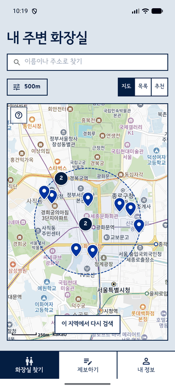 | 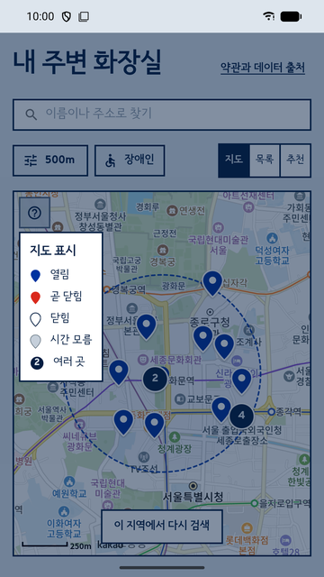 | 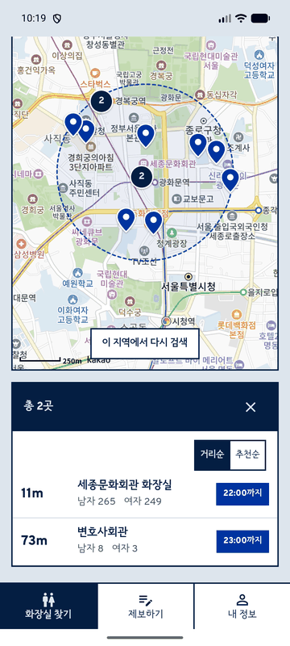 |
| 내 위치 주변(기본 500m)의 화장실을 **핀 모양**으로 보여 준다. 글자 없이 모양과 색으로 개방 상태(열림·곧 닫힘·닫힘·모름)를 나타낸다 | 지도 왼쪽 위 반투명 **?** 단추를 누르면 핀 모양의 뜻이 뜬다 | 핀이 절반 넘게 겹치면 숫자가 적힌 **묶음 마커**가 된다. 누르면 그 화장실들을 **거리순·추천순**으로 보여 준다 |

| 화장실 정보 카드 | 목록 | 추천 |
|:-:|:-:|:-:|
| 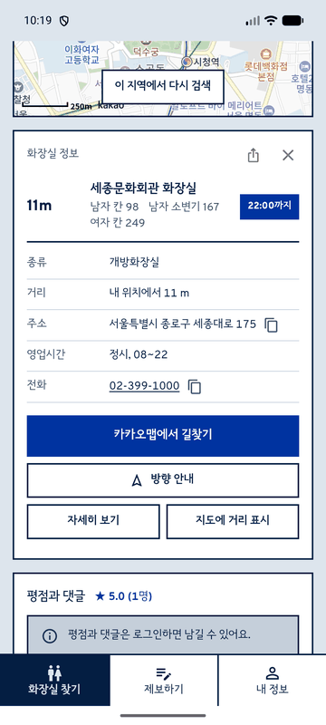 | 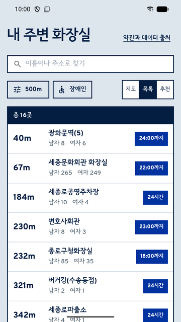 | 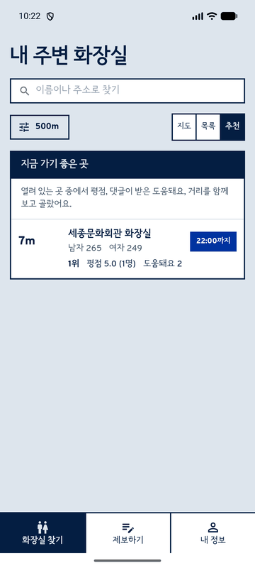 |
| 핀을 고르면 거리, 시설, 주소, 영업시간, 전화와 함께 **카카오맵 길찾기 / 방향 안내 / 자세히 보기**가 뜬다. 오른쪽 위에 공유와 닫기 | 출발 안내판처럼 한 줄에 거리, 이름과 시설, 개방 상태 | 열린 곳 중에서 평점, 댓글이 받은 도움돼요, 거리를 함께 보고 고른 "지금 가기 좋은 곳" |

| 필터 |
|:-:|
| 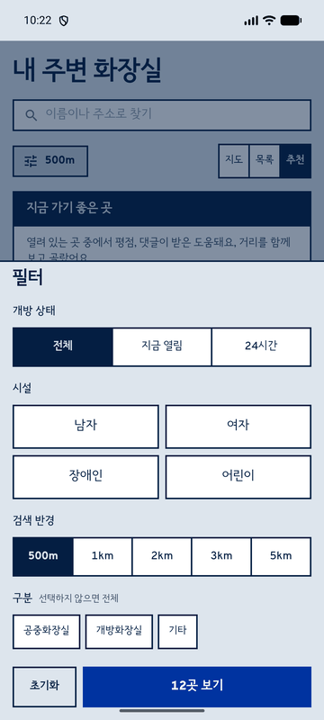 |
| 개방 상태(전체·지금 열림·24시간), 시설(남자·여자·장애인·어린이), 검색 반경(500m~5km), 구분. 결과 수가 바로 보인다 |

### 상세

| 상세 위쪽 | 개방 시간과 시설 | 공유 |
|:-:|:-:|:-:|
| 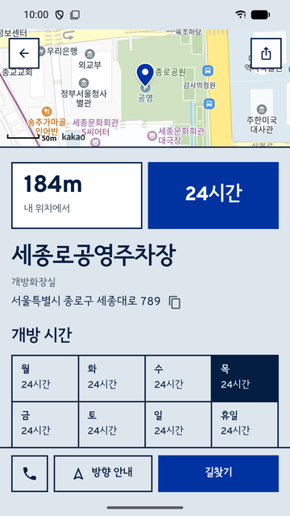 | 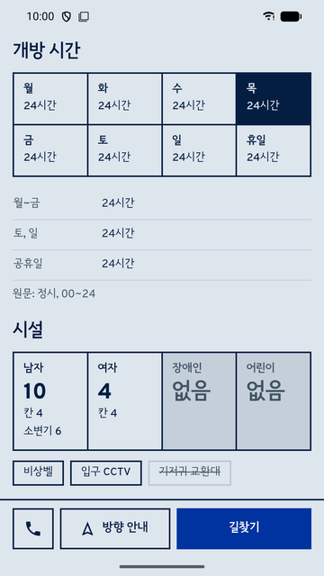 | 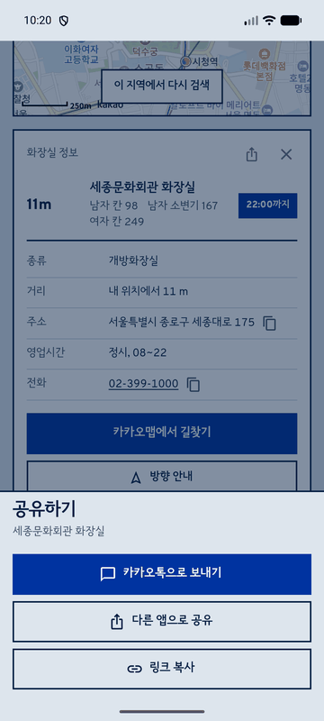 |
| 거리 판과 상태 판(닫기까지 남은 시간). 하단 바에 전화, **방향 안내**, 카카오맵 길찾기 | 요일 8칸(오늘은 잉크 칸)과 평일·주말·공휴일 묶음, 정규화 전 **원문**. 시설 4칸과 비상벨·CCTV·기저귀 교환대 | **카카오톡**(위치 카드, "위치 보기" 버튼 포함), **다른 앱**(시스템 공유 창), **링크 복사** |

### 방향 안내 (앱 안)

| 걷는 중 | 도착 |
|:-:|:-:|
| 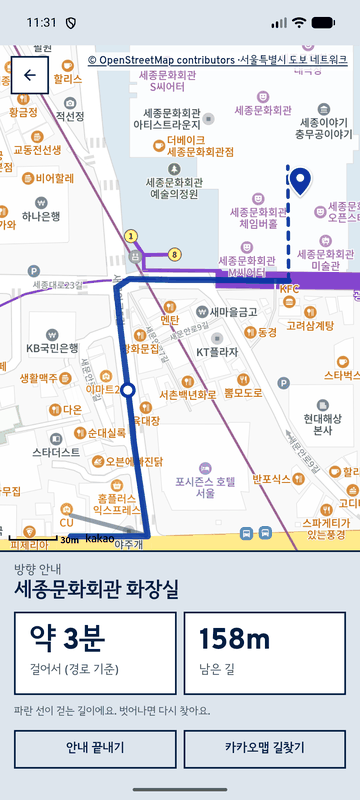 | 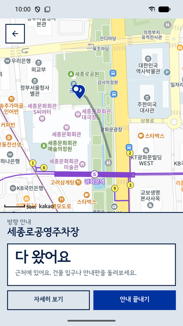 |
| 서버가 찾은 **실제 도보 경로(파란 선)**와 지나온 길(회색), 경로 기준 남은 시간·거리. 서울은 서울시 도보 네트워크(횡단보도·육교 포함), 그 밖은 OpenStreetMap. 경로가 길에서 끝나면 화장실까지 점선으로 잇는다. 35m 넘게 벗어나면 다시 찾고, 경로를 못 받으면 일직선 안내로. 앱이 GPS 를 1초 간격으로 따라가고(`watchLocation` 브리지), 앱이 화면에서 내려가면 쉰다 | 20m 안에 들어오면 "다 왔어요"로 바뀌고 GPS 를 끈다. 카카오맵 길찾기(도보·차)는 늘 옆에 둔다 |

이 밖에 웹에서: 이름·주소 검색, 평점과 댓글(도움돼요/아니에요, 신고), 새 화장실·정보 수정 제보, 내 정보와 설정(이름 바꾸기, 언어, 로그아웃, 회원 탈퇴), 관리자 화면.

## 문서

| 문서 | 내용 |
|---|---|
| [docs/01-requirements.md](docs/01-requirements.md) | 요구사항 정의서: 기능·비기능, 데이터 표준, 법률·스토어 요건, 현행 갭, 마일스톤, 미결 사항 |
| [docs/02-erd.md](docs/02-erd.md) | ERD (목표 스키마), 제약·인덱스, 표준 값 결정 규칙 |
| [docs/03-class-diagram.md](docs/03-class-diagram.md) | 클래스 다이어그램: 도메인, 정규화 파이프라인, API 서비스, Flutter 셸 + JS 브리지 프로토콜 |
| [docs/04-sequence-diagrams.md](docs/04-sequence-diagrams.md) | 시퀀스 다이어그램 16종 |
| [docs/05-operations.md](docs/05-operations.md) | 운영 설계: 일일 데이터 갱신, 무중단 배포, 점검 모드 |
| [docs/06-data-profile.md](docs/06-data-profile.md) | LOCALDATA 전국파일 프로파일링 결과 (P0) |
| [docs/07-ui-design.md](docs/07-ui-design.md) | UI 디자인 결정: Wayfind 방향, 색 토큰(라이트/다크), 서체, 지도 핀과 묶음, 화면별 결정, 앱 아이콘 사양 |
| [docs/08-infrastructure.md](docs/08-infrastructure.md) | 배포 인프라 설계: 구성도, 네트워크·보안, 배포 파이프라인, 백업·복구, 감시, 출시 체크리스트 |

다이어그램은 Mermaid로 작성했다. VS Code(Markdown Preview Mermaid Support 확장)나 GitHub에서 렌더링된다.

## 관련 저장소

- 웹 프런트: `D:\code\Mashil-web` (Vite + React 19 + MUI)
- 백엔드: `D:\code\C#\Mashil` (ASP.NET Core 10 + EF Core + PostGIS, `tools/Mashil.CsvImport`)

## 개발 환경

빌드 환경 설정은 `app/env/*.json` (커밋하지 않음, 형식은 `env/example.json`): `dev.json` (에뮬레이터 → PC 개발 서버), `staging.json` (`https://toilets-dev.ironhiro.dev`), `prod.json` (`https://toilets.ironhiro.dev`). 예: `flutter build apk --dart-define-from-file=env/prod.json`.

Flutter **3.47 이상** (개발·CI 는 3.50.0, Dart 3.14). 그보다 낮으면 `flutter pub get` 이 "Flutter SDK version" 오류로 멈춘다. `flutter upgrade` 로 올리고, iOS 는 그다음 `cd app/ios && pod install`.

## 사용한 오픈소스 (Flutter 앱, `app/`)

버전은 `app/pubspec.lock` 에 실제로 받은 것 (2026-11-16). 라이선스는 각 패키지의 LICENSE 파일 기준.

### 앱에 들어가는 것

| 패키지 | 버전 | 라이선스 | 쓰는 곳 |
|---|---|---|---|
| [Flutter SDK](https://github.com/flutter/flutter) (+ `flutter_localizations`) | 3.50.0 | BSD-3-Clause | 앱 프레임워크, 다국어 |
| [intl](https://pub.dev/packages/intl) | 0.20.3 | BSD-3-Clause | 다국어 문구 (ARB) |
| [material_ui](https://pub.dev/packages/material_ui) | 1.11.0 | BSD-3-Clause | 네이티브 화면 위젯 |
| [cupertino_icons](https://pub.dev/packages/cupertino_icons) | 1.0.9 | MIT | iOS 아이콘 |
| [webview_flutter](https://pub.dev/packages/webview_flutter) (+ `_android` 4.14.1, `_wkwebview` 3.27.2) | 4.14.1 | BSD-3-Clause | 마실 웹을 띄우는 웹뷰 |
| [geolocator](https://pub.dev/packages/geolocator) | 14.0.1 | MIT | 현재 위치 (JS 브리지 `getLocation`), 방향 안내의 위치 따라가기 (`watchLocation`) |
| [permission_handler](https://pub.dev/packages/permission_handler) | 13.0.2 | MIT | 위치 권한, 설정 앱 열기 |
| [url_launcher](https://pub.dev/packages/url_launcher) | 6.3.3 | BSD-3-Clause | 카카오맵 길찾기, 전화, 외부 링크 |
| [connectivity_plus](https://pub.dev/packages/connectivity_plus) | 7.3.2 | BSD-3-Clause | 오프라인 화면, 다시 연결되면 재시도 |
| [package_info_plus](https://pub.dev/packages/package_info_plus) | 10.2.2 | BSD-3-Clause | 앱 버전 (업데이트 안내) |
| [kakao_flutter_sdk_user](https://pub.dev/packages/kakao_flutter_sdk_user) | 2.1.0 | Apache-2.0 | 카카오 로그인 |
| [kakao_flutter_sdk_share](https://pub.dev/packages/kakao_flutter_sdk_share) | 2.1.0 | Apache-2.0 | 카카오톡 공유 (위치 카드, 카카오톡이 없으면 웹 공유 화면) |
| [share_plus](https://pub.dev/packages/share_plus) | 13.3.1 | BSD-3-Clause | 시스템 공유 창 (다른 앱으로 공유) |
| [google_sign_in](https://pub.dev/packages/google_sign_in) | 7.2.0 | BSD-3-Clause | Google 로그인 |
| [sign_in_with_apple](https://pub.dev/packages/sign_in_with_apple) | 8.2.0 | MIT | Apple 로그인 |
| [http](https://pub.dev/packages/http) | 1.6.0 | BSD-3-Clause | 버전 확인 API 호출 |
| [shared_preferences](https://pub.dev/packages/shared_preferences) | 2.5.6 | BSD-3-Clause | 앱 언어 저장 |
| [crypto](https://pub.dev/packages/crypto) | 3.0.8 | BSD-3-Clause | 로그인 nonce 해시 |

### 개발 도구

| 패키지 | 버전 | 라이선스 | 쓰는 곳 |
|---|---|---|---|
| [flutter_lints](https://pub.dev/packages/flutter_lints) | 6.0.0 | BSD-3-Clause | `flutter analyze` 규칙 |
| `flutter_test` (Flutter SDK) | 3.50.0 | BSD-3-Clause | 단위 테스트 |
| GitHub Actions (`actions/checkout`, `subosito/flutter-action`) | — | MIT | CI (`.github/workflows/ci.yml`) |
| [Mermaid](https://github.com/mermaid-js/mermaid) | — | MIT | `docs/` 다이어그램 (GitHub 이 렌더링) |

앱이 띄우는 웹과 백엔드의 오픈소스는 각 저장소 README 에 있다 (Mashil-Front, Mashil-Back).

## 외부 서비스

| 항목 | 쓰는 곳 | 조건 |
|---|---|---|
| Kakao 로그인, Google 로그인, Sign in with Apple | 소셜 로그인 | 각 제공자 약관. 앱 키는 `env/*.json`, `ios/Flutter/Secrets.xcconfig` (저장소에 넣지 않음) |
| [카카오맵](https://map.kakao.com/) 앱·웹 | 길찾기 | 카카오맵 이용약관 |
| 카카오톡 공유 | 화장실 공유 (위치 카드) | Kakao Developers 약관. 카드 링크 도메인은 콘솔 [제품 링크 관리] > [웹 도메인]에 등록해야 열린다 (등록하지 않은 도메인은 기본값으로 바뀐다) |

