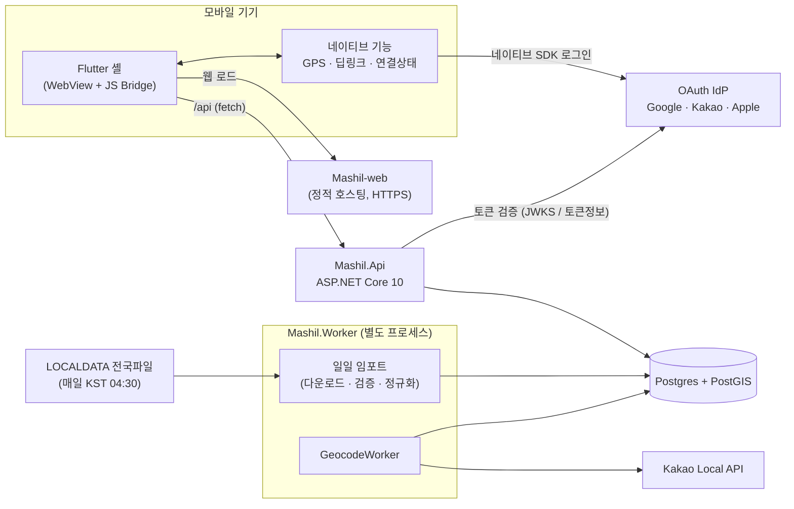

# 마실(Mashil) 앱 요구사항 정의서

| 항목 | 내용 |
|---|---|
| 문서 버전 | v0.4 (초안) |
| 변경 이력 | v0.1 최초 작성 · v0.2 회원가입·로그인을 OAuth(Google, Kakao, Apple)로 전환 (USR-01~06, APP-12, STO-04, LEG-05, G9) · v0.3 데이터 소스를 LOCALDATA 전국파일로 정하고 일일 자동 갱신 추가, 무중단 배포·점검 모드 요구사항 추가 (DATA-18~23, NFR-13~16, OPS-01~06, G10, Q10~11) · v0.4 전국파일 프로파일링 반영: 좌표 컬럼 없음(전량 지오코딩), 실제 인코딩 CP949, 개방시간 상태 추가, 구분 코드 확정 (DATA-24~26, G11 수정, G12, §6.2, §6.3) |
| 작성일 | 2026-11-14 |
| 대상 | 마실 모바일 앱 (Flutter 셸) + 화장실 데이터 표준화 파이프라인 |
| 관련 저장소 | `D:\code\Mashil-web` (React 웹), `D:\code\C#\Mashil` (ASP.NET Core API + CsvImport) |
| 관련 문서 | [02-erd.md](02-erd.md) · [03-class-diagram.md](03-class-diagram.md) · [04-sequence-diagrams.md](04-sequence-diagrams.md) · [05-operations.md](05-operations.md) · [06-data-profile.md](06-data-profile.md) |

---

## 1. 개요

### 1.1 목적
기존 마실 웹(공중·개방 화장실 찾기, 평점, 댓글, 정보 변경 요청)을 **Flutter 앱으로 감싸서 iOS와 Android 스토어에 출시**한다. 공공데이터의 형식이 지자체마다 달라 생기는 품질 문제는 **마실 자체 표준 스키마로 정규화하는 파이프라인**을 만들어 해결한다.

### 1.2 범위

| 구분 | 포함 | 제외 (향후 검토) |
|---|---|---|
| 앱 | Flutter 웹뷰 셸, 네이티브 위치 권한과 브리지, 외부 길찾기 앱 연동, **앱 안 방향 안내(직선)**, **카카오톡·시스템 공유**, 오류와 오프라인 화면, 버전 체크 | UI 전체의 네이티브 재작성, 푸시 알림, 위젯 |
| 데이터 | LOCALDATA 공중화장실정보 전국파일 **일 1회 자동 갱신**, 정규화, 원본 보존, 검수 큐 | 실시간 혼잡도, 사용자 사진 업로드 |
| 운영 | 무중단 배포, 점검 모드, 갱신 실패 알림 | 다중 리전 |
| 백엔드 | 정규화 테이블과 API, 변경 요청 승인 반영, 신고·차단, 계정 삭제, **OAuth 소셜 로그인 (Google, Kakao, Apple)** | 이메일·비밀번호 가입 (폐지), 계정 통합 (동일인의 다중 소셜 계정 연결) |
| 운영 | 운영 환경 배포, 스토어 심사 대응, 법적 신고 | — |
| 수익화 | 광고 제거·후원 카드 자리 (결제는 막아 둠, §4.9) | 광고 SDK, 인앱 결제, 앱 안 실제 도보 경로 (계획, §4.9) |

### 1.3 용어

| 용어 | 정의 |
|---|---|
| 원본 레코드 (Raw Record) | 데이터 소스(CSV 등)의 한 행을 **변형 없이** 저장한 것 |
| 정규화 (Normalization) | 원본 값을 마실 표준 스키마(코드값, 구조화된 스케줄 등)로 변환하는 과정 |
| 표준 화장실 (Canonical Toilet) | 정규화 결과와 오버라이드를 합쳐 서비스에 노출하는 최종 레코드 (`toilets`) |
| 오버라이드 (Override) | 관리자 수정, 승인된 변경 요청, 지오코딩 결과처럼 **원본보다 우선하는** 필드 값 |
| 정규화 이슈 | 자동 정규화에 실패했거나 의심스러운 값. 관리자 검수 큐에 쌓인다 |
| 매핑 사전 (Value Mapping) | `원본 문자열 → 표준 값` 매핑 규칙. 관리자가 코드 배포 없이 추가할 수 있다 |
| 셸 (Shell) | 웹을 웹뷰로 띄우고 네이티브 기능을 제공하는 Flutter 앱 |
| IdP (Identity Provider) | 외부 인증 제공자. 마실에서는 Google, Kakao, Apple |
| 외부 계정 연결 (Identity) | `(provider, provider_subject)` 쌍. 마실 사용자 1명에 연결된다 |

---

## 2. 사용자와 이해관계자

| 액터 | 설명 | 주요 권한 |
|---|---|---|
| 비로그인 사용자 | 앱을 설치하고 가입하지 않은 사용자 | 지도·목록 조회, 상세 보기, 길찾기 |
| 회원 | 소셜 계정(Google, Kakao, Apple)으로 가입한 사용자 | 비로그인 권한 + 평점, 댓글, 변경 요청, 신고, 차단, 계정 삭제 |
| 관리자 | `UserRole.Admin` | 회원 권한 + 변경 요청 승인, 댓글 숨김, 정규화 이슈 검수, 매핑 사전 관리, 임포트 실행 |
| 스케줄러 (시스템) | 백그라운드 작업 | 정기 임포트, 지오코딩 워커 |
| 외부 시스템 | LOCALDATA (file.localdata.go.kr), Kakao Local API, Kakao Maps JS SDK, OAuth IdP, 앱스토어 | — |

---

## 3. 시스템 구성 (목표)

---

## 4. 기능 요구사항

우선순위는 **M**(Must, 출시 필수), **S**(Should, 출시 권장), **C**(Could, 출시 후)로 표기한다.

### 4.1 앱 셸 (APP)

| ID | 요구사항 | 상세 / 수용 기준 | 우선 |
|---|---|---|---|
| APP-01 | 웹뷰 로딩 | 운영 웹 URL을 웹뷰로 로드한다. 로딩 중에는 스플래시나 진행 표시를 보여준다. | M |
| APP-02 | 위치 권한 처리 | 네이티브에서 위치 권한을 요청한다. 거부 시 "기본 위치(서울시청)로 보기" 안내. "다시 묻지 않음" 상태면 설정 앱으로 이동하는 버튼을 제공한다. | M |
| APP-03 | 위치 JS 브리지 | 웹이 `MashilBridge.getLocation()`을 호출하면 네이티브 GPS 좌표를 반환한다. 브리지가 없는 브라우저 환경에서는 `navigator.geolocation`으로 폴백한다. | M |
| APP-04 | 외부 길찾기 연동 | 상세 화면의 "길찾기"로 카카오맵 앱 딥링크를 연다. 앱이 없으면 웹 길찾기를 연다. 네이버지도·티맵은 선택 사항이다. 앱 안 방향 안내(APP-13)가 있어도 이 버튼은 늘 함께 둔다 (실제 길은 카카오맵). | M |
| APP-05 | 뒤로가기 처리 | Android 뒤로가기 시 웹뷰 history가 있으면 뒤로 간다. 없으면 "한 번 더 누르면 종료"로 처리한다. | M |
| APP-06 | 오류·오프라인 화면 | 네트워크가 끊기거나 웹 로드가 실패하면 네이티브 오류 화면과 재시도 버튼을 보여준다. | M |
| APP-07 | 외부 링크 처리 | 마실 도메인이 아닌 링크와 `tel:` 링크는 외부 브라우저나 전화 앱으로 연다. | M |
| APP-08 | 인증 상태 유지 | 앱을 재실행해도 로그인이 유지된다 (웹뷰 저장소 유지). | M |
| APP-12 | **네이티브 소셜 로그인 브리지** | 앱에서는 웹뷰 안에서 OAuth를 진행하지 않는다 (Google이 임베디드 웹뷰 로그인을 차단함, `disallowed_useragent`). 웹이 `MashilBridge.signIn(provider)`를 호출하면 네이티브 SDK(Google Sign-In, Kakao SDK, Sign in with Apple)로 로그인하고, 받은 토큰을 웹에 돌려준다. 웹은 그 토큰을 백엔드에 교환 요청한다 (USR-01). | M |
| APP-09 | 버전 체크 | 시작할 때 `/api/app/version`을 조회한다. 최소 지원 버전보다 낮으면 강제 업데이트, 최신이 아니면 권장 업데이트를 안내한다. | S |
| APP-10 | 공유 | **구현 (2026-11-16).** 상세와 홈 카드의 공유 단추로 시트를 연다: **카카오톡으로 보내기**(위치 카드: 이름, 종류, "마실에서 보기", 주소가 있으면 "위치 보기"), **다른 앱으로 공유**(시스템 공유 창), **링크 복사**. • 앱: 브리지 `share` → 네이티브 Kakao 공유 SDK (카카오톡이 없으면 카카오 웹 공유 화면), `share_plus`. 허용 호스트의 링크만 공유한다. • 브라우저: Kakao JS SDK(버전 고정, SRI)와 Web Share API. • 링크는 웹 상세 `/toilets/{id}`. 바탕 주소는 `VITE_PUBLIC_WEB_URL`(운영 도메인). 카드 링크 도메인은 Kakao 콘솔 [제품 링크 관리] > [웹 도메인]에 등록해야 한다 (등록하지 않으면 기본값으로 바뀐다). | S |
| APP-11 | 앱 딥링크 | `https://<도메인>/toilets/{id}` 링크를 앱에서 연다 (App Links / Universal Links). 운영 도메인이 생긴 뒤에 (지금 공유 링크는 웹으로 열린다). | C |
| APP-13 | **앱 안 방향 안내** | **구현 (2026-11-16). 실제 도보 경로가 있으면 그것을, 없으면 직선을 보여 준다 (MON-03, 아래 "도보 경로").** 상세와 홈 카드의 "방향 안내"로 `/toilets/{id}/guide` 를 연다. 내 위치에서 화장실까지 **일직선(점선)**, 지나온 길(실선), 걷는 시간 어림(직선 거리 × 1.3, 4km/h)과 직선 거리·방위(8방위)를 보여 준다. 20m(위치 오차가 크면 최대 35m) 안이면 "다 왔어요"로 바꾸고 위치 따라가기를 끈다. 위치 오차가 50m를 넘으면 알린다. 카카오맵 길찾기 단추는 늘 함께. • 앱: 브리지 `watchLocation`·`stopWatchLocation` (Android 1초 간격, 3m 거리 필터). 앱이 화면에서 내려가면 쉬고 돌아오면 다시 붙는다. 백그라운드 위치 권한은 쓰지 않는다 (STO-06). • 브라우저: `navigator.geolocation.watchPosition`. • 모든 사용자 무료. 실제 도보 경로는 MON-03 (계획). | S |

### 4.2 화장실 조회 (MAP)

| ID | 요구사항 | 상세 / 수용 기준 | 우선 |
|---|---|---|---|
| MAP-01 | 근접 검색 | 현재 위치 기준 반경(500m~10km) 안의 화장실을 거리순으로 조회한다. (기존 `/api/toilets/near`) | M |
| MAP-02 | 지도·목록 전환 | 지도 마커 보기와 목록 보기를 전환할 수 있다. | M |
| MAP-03 | 시설 필터 | 남성·여성·장애인·어린이 시설 유무로 필터링한다. | M |
| MAP-04 | 상세 정보 | 이름, 주소, 시설 수, 개방 시간(요일별), 전화, 평균 평점, 댓글을 보여준다. | M |
| MAP-05 | **개방 상태 표시 (개선)** | 구조화된 스케줄로 **요일, 휴무일, 공휴일을 반영해** `24시간 / 영업중(~HH:MM) / 영업종료(다음 개방 요일 HH:MM) / 정보없음`을 표시한다. 판정 기준 시각은 KST. | M |
| MAP-06 | 텍스트 검색 | 이름이나 주소로 검색한다. 위치가 확정되지 않은 레코드도 포함한다. (기존 `/api/toilets/search`) | S |
| MAP-07 | 데이터 출처 표시 | 상세 화면에 "출처: LOCALDATA (데이터 기준일자 / 마지막 갱신일)"과, 관리자 수정이 반영된 경우 그 사실을 표시한다. | M |
| MAP-08 | 부가 시설 표시 | 비상벨, CCTV, 기저귀 교환대 유무를 아이콘으로 표시한다. | S |
| MAP-09 | "지금 열린 곳만" 필터 | 개방 상태가 `24h` 또는 `open`인 곳만 보여준다. | S |
| MAP-10 | **지도 핀과 묶음** | **구현 (2026-11-16).** 지도 마커는 글자 없이 **핀 모양**으로 개방 상태 4단계를 나타낸다 (색만이 아니라 채움·테두리·안쪽 표시가 다름). 화면에서 핀이 **절반 넘게 겹치면** 숫자가 적힌 둥근 묶음 마커로 합친다 (겹침을 이어 붙이지 않아 묶음 하나가 넓은 범위를 덮지 않는다). 묶음을 누르면 "총 n곳" 목록을 **거리순 / 추천순**(서버 추천식과 같은 식, 도움돼요 수는 `/near` 에 없어 중립값)으로 보여 준다. 고른 핀은 묶지 않는다. 지도 왼쪽 위 반투명 "?" 단추로 핀 모양 설명. | S |
| MAP-11 | 추천 | "지금 가기 좋은 곳" 최대 5곳: 닫힌 곳 제외, 평점(베이지안) 50%, 댓글 도움돼요 비율 30%, 가까움 20% (`GET /api/toilets/recommended`). | S |

### 4.3 계정 (USR)

| ID | 요구사항 | 상세 / 수용 기준 | 우선 |
|---|---|---|---|
| USR-01 | **OAuth 가입·로그인 통합** | 별도 가입 절차 없이 소셜 로그인 한 번으로 처리한다. 처음 로그인하면 자동 가입되고, 이후에는 로그인된다. • 제공자: **Google, Kakao** (전 플랫폼), **Apple** (iOS 필수, STO-04 / Android와 웹은 선택) • 흐름: 클라이언트가 IdP 토큰(ID Token 또는 Access Token)을 받아 `POST /api/auth/oauth/{provider}`로 보낸다. 서버가 IdP 공개키나 토큰 정보 API로 **직접 검증**한 뒤 마실 JWT를 발급한다. • 식별자는 `(provider, provider_subject)`. **이메일은 식별에 쓰지 않는다** (Kakao는 이메일 제공이 선택 동의이고, Apple은 이메일 가리기를 허용함). • 처음 가입할 때는 약관, 개인정보처리방침, 위치기반서비스 이용약관 동의 화면을 1회 보여주고, 동의 버전과 시각을 저장한다. • 표시 이름은 IdP 닉네임을 기본값으로 쓰고 변경할 수 있다. | M |
| USR-02 | 로그인 유지·로그아웃 | 마실 JWT(Access, 짧은 만료)와 Refresh Token(회전 방식)을 발급한다. 로그아웃하면 서버의 Refresh Token을 폐기하고 IdP 세션도 로그아웃한다 (SDK `signOut`). | M |
| USR-03 | **앱 내 계정 삭제** | 설정 화면(`/me/settings`, 내 정보의 회원 카드를 누르면 열림)에서 계정을 삭제한다. 프로필은 즉시 비활성화하고 개인정보는 파기한다. 댓글은 "탈퇴한 사용자"로 익명 처리한다 (Apple 심사 필수 요건). • 확인: 테마 오류색 경고창 "정말 탈퇴하시겠어요?" (지워지는 것, 남는 것 안내). 본인 확인 전에는 탈퇴 단추가 꺼져 있다. • 재인증: 비밀번호 대신 **해당 IdP로 다시 로그인**해서 본인을 확인한다 (레거시 이메일 계정은 비밀번호). 소셜 계정은 앱에서만 탈퇴할 수 있다 (재인증이 네이티브 SDK). • API: `POST /api/auth/me/withdraw`. 본문이 있는 `DELETE` 는 중간 장비가 본문을 버릴 수 있어 POST 로 바꿨다 (2026-11-16). 예전 `DELETE /api/auth/me` 는 이전 앱용으로 당분간 받는다. • IdP 연결 해제: Kakao `unlink`, Apple `revoke`(Apple 로그인 사용자의 계정을 삭제할 때 토큰 폐기가 필요함), Google `revoke`. | M |
| USR-04 | 웹 브라우저 로그인 | 앱이 아닌 일반 브라우저에서는 Google Identity Services와 Kakao JS SDK의 리다이렉트 방식으로 로그인한다. 결과 토큰 교환은 USR-01과 같은 API를 쓴다. | S |
| USR-05 | 동일 IdP 재가입 | 탈퇴한 사용자가 같은 소셜 계정으로 다시 로그인하면 새 계정으로 가입한다 (이전 데이터와 연결하지 않음). | M |
| USR-06 | 다중 계정 연결 | 한 사용자가 Google과 Kakao를 둘 다 연결한다. 이메일이 같다는 이유로 자동 병합하지 않고, 로그인한 상태에서 명시적으로 연결한다. | C |
| USR-07 | 내 정보와 설정 | **구현 (2026-11-16).** 내 정보: 회원 카드(이름, 역할, 로그인 방법; 누르면 설정) → 내 제보 → 내 댓글 → 광고 제거·후원 카드(회원만, MON) → 관리자 메뉴. 비회원은 로그인 안내와 언어만. 설정: 표시 이름 바꾸기(`PATCH /api/auth/me`, 20자), 언어, 로그아웃, 회원 탈퇴(USR-03). | M |

### 4.4 사용자 콘텐츠 (UGC)

| ID | 요구사항 | 상세 / 수용 기준 | 우선 |
|---|---|---|---|
| UGC-01 | 평점 | 1~5점. 사용자당 화장실 1건씩 upsert한다. | M |
| UGC-02 | 댓글 작성·조회 | 숨김 처리된 댓글과 차단한 사용자의 댓글은 노출하지 않는다. | M |
| UGC-03 | **댓글 신고** | 사유(스팸, 욕설, 허위, 기타)를 골라 신고한다. 같은 댓글은 한 사용자가 한 번만 신고할 수 있다. | M |
| UGC-04 | **사용자 차단** | 차단한 사용자의 댓글을 본인 화면에서 숨긴다. | M |
| UGC-05 | 관리자 숨김 | 관리자가 신고 큐에서 댓글을 숨기거나 복원한다. | M |
| UGC-06 | 금칙어 필터 | 등록 시점에 금칙어가 포함되면 거부하거나 자동 숨김 처리한다. | S |
| UGC-07 | 본인 댓글 수정·삭제 | — | S |

### 4.5 변경 요청 (CR)

| ID | 요구사항 | 상세 / 수용 기준 | 우선 |
|---|---|---|---|
| CR-01 | 요청 제출 | 회원이 추가, 수정, 삭제 요청을 제출한다. (기존) | M |
| CR-02 | 관리자 검토 | 대기 큐에서 승인하거나 반려하고 메모를 남긴다. (기존) | M |
| CR-03 | **승인 시 반영** | 승인 트랜잭션에서 수정 요청은 `toilet_overrides`를, 추가 요청은 `toilets`(source = UserSubmitted)를 생성하고, 삭제 요청은 `toilets.status = Removed`로 바꾼다. **재임포트해도 덮어써지지 않아야 한다.** (현재 TODO) | M |
| CR-04 | 요청자 결과 확인 | 본인 요청의 상태와 반려 사유를 조회한다. | S |
| CR-05 | **Kind 값 통일** | 프런트 `Update`와 백엔드 `Edit`이 불일치한다. `Edit`으로 통일한다. | M |

### 4.6 데이터 표준화 (DATA)

| ID | 요구사항 | 상세 / 수용 기준 | 우선 |
|---|---|---|---|
| DATA-01 | 데이터 소스 등록 | 소스별 메타데이터(제공기관, 형식, 인코딩, 헤더 매핑, 갱신 주기)를 `data_sources`로 관리한다. | M |
| DATA-02 | 임포트 실행 기록 | 실행마다 `import_runs`에 파일 해시, 행 수, 성공·스킵·이슈 수, 정규화 버전, 소요 시간을 남긴다. 같은 파일 해시는 재실행하지 않는다 (강제 옵션 제외). | M |
| DATA-03 | 원본 보존 | 모든 행을 `raw_toilet_records.payload`(jsonb)에 그대로 저장한다. `row_hash`로 변경 여부를 판단한다. | M |
| DATA-04 | 소스 어댑터 | 소스별 헤더와 인코딩(CP949, UTF-8) 차이를 어댑터가 흡수해서 공통 `SourceRow`로 변환한다. | M |
| DATA-05 | **개방시간 구조화** | `개방시간`과 `개방시간상세` 자유 텍스트를 요일별 `opening_schedules` 시간대로 변환한다 (§6.3). 파싱에 실패하면 `schedule_status = Unknown`으로 두고 이슈를 생성한다. | M |
| DATA-06 | 코드값 정규화 | 구분명을 `ToiletKind`로, Y/N 변형(`Y`, `y`, `예`, `유`, `O`, `설치` 등)을 bool로, 소유구분과 오물처리방식을 코드로 변환한다. | M |
| DATA-07 | 전화번호 정규화 | 숫자만 추출한 뒤 국내 표기(`02-2148-2832`)로 변환한다. 자릿수가 맞지 않으면 null로 두고 이슈를 생성한다. | S |
| DATA-08 | 좌표 검증 | 국내 범위(위도 33.0~38.7, 경도 124.5~132.0)를 벗어나거나, 0값이거나, 위경도가 뒤바뀐 경우를 판정한다. 뒤바뀐 경우는 자동 교정하고 이슈(Info)를 남긴다. | M |
| DATA-09 | 주소·좌표 교차 검증 | 지오코딩한 주소 좌표와 CSV 좌표가 500m 이상 떨어지면 `CoordinateMismatch` 이슈를 생성한다. | S |
| DATA-10 | **지오코딩 (핵심 경로)** | LOCALDATA 파일에는 **좌표가 없다** (06-data-profile F1). 주소가 있는 약 53,320건 전부를 기존 `GeocodeWorker`로 지오코딩한다. 결과는 `toilet_overrides`(source = Geocode)에 저장해서 재임포트 후에도 유지한다. 주소가 바뀌면 다시 지오코딩한다. 최초 적재는 Kakao 일일 할당량 안에서 나눠 처리하고, 진행률을 관리자 화면에 표시한다. | M |
| DATA-11 | **오버라이드 우선 병합** | 표준 값은 `관리자 오버라이드 > 승인된 변경 요청 > 지오코딩 > 정규화된 원본` 순서로 결정한다. 재임포트는 원본과 정규화 결과만 갱신하고 오버라이드는 유지한다. | M |
| DATA-12 | 정규화 이슈 큐 | 이슈 유형, 원본 값, 제안 값, 상태(Open/Resolved/Ignored)를 관리하고, 관리자가 해결하거나 무시한다. | M |
| DATA-13 | 매핑 사전 | 관리자가 `필드 + 원본 문자열 → 표준 값` 규칙을 추가한다. 추가하면 같은 원본 값을 가진 레코드 전체를 재정규화한다. | M |
| DATA-14 | 재정규화 | 정규화 로직 버전이 오르면 저장된 원본에서 전체를 재실행할 수 있다 (CSV 재다운로드 불필요). | M |
| DATA-15 | 소멸 레코드 처리 | 최신 임포트에 없는 관리번호는 즉시 삭제하지 않고 `status = Missing`으로 표시한다. **사전 검증을 통과한 성공 실행 기준으로** 3회 연속 누락되면 `Removed`로 바꾼다. 한 번에 Removed로 바뀌는 건수가 전체의 1%를 넘으면 보류하고 관리자 승인을 기다린다. | M |
| DATA-16 | 정규화 리포트 | 임포트 후 필드별 성공률(예: 개방시간 파싱 92.3%)과 상위 미해결 원본 값 Top 50을 출력한다. | S |
| DATA-17 | 다중 소스 병합 | 지자체 개방화장실 데이터 등을 추가로 받을 때, 좌표 30m 이내이고 이름 유사도가 기준 이상이면 동일 후보로 묶는다. | C |
| DATA-18 | **일일 자동 갱신** | 매일 1회(기본 KST 04:30, 원본 갱신 시각 확인 후 조정) LOCALDATA 전국파일을 자동으로 내려받아 임포트한다. 파일 해시가 직전 성공과 같으면 건너뛴다. 무중단으로 처리한다 ([05-operations.md §2](05-operations.md)). | M |
| DATA-19 | 다운로더 | 다운로드 방식(고정 URL / 폼 POST / 세션)은 Q10 확인 결과에 따라 구현하고 `data_sources`에 설정으로 둔다. 재시도 3회와 지수 백오프. 압축 파일이면 해제한다. **다운로드가 막히면 관리자가 파일을 수동 업로드해서 같은 파이프라인을 실행할 수 있어야 한다.** | M |
| DATA-20 | **사전 검증 (반영 거부)** | 필수 헤더 존재, 파일 크기 ±30%, 행 수가 직전 대비 5% 넘게 감소하지 않음, 손상 행 1% 미만. 하나라도 실패하면 **DB에 전혀 쓰지 않고** 기존 데이터를 유지한다. | M |
| DATA-21 | 실패 알림 | 다운로드 실패, 검증 거부, 대량 삭제 보류, 마지막 성공 후 48시간 경과 시 관리자에게 알림 (이메일 또는 웹훅). | M |
| DATA-22 | 중복 실행 방지·멱등성 | Postgres advisory lock으로 동시에 하나만 실행한다. 중간에 끊겨도 재실행하면 같은 결과가 나와야 한다. heartbeat가 끊긴 실행은 Abandoned로 정리한다. | M |
| DATA-24 | 주소 보정·후보 선택 | 지오코딩 질의에서 **상세 주소를 뺀다** (Kakao 권장): 도로명은 `…로/길 [지하] 건물번호`까지, 지번은 `…동/리/가 [산] 본번-부번`까지만 남기고 건물명·층·호·출입구·쉼표 뒤 정보를 지운다. 그 전에 시도 오타·약칭, 띄어쓰기 없는 주소, `번지`·`N호` 표기, `○○로N번길` 결합을 보정한다 ([06-data-profile.md §9.3](06-data-profile.md)). **자른 질의의 결과는 도로명(법정동)과 본번이 원문과 같을 때만 채택한다** (잘라서 다른 실제 주소에 매칭되는 것을 막음). Kakao 결과가 여러 건이면 `개방자치단체코드`로 추정한 시도와 맞는 후보를 고르고, 단건 결과는 코드와 달라도 뒤집지 않는다 (이슈 Info만 남김). 보정 전 원문은 raw에 남긴다. | M |
| DATA-25 | 지오코딩 캐시·호출 예산 | `geocode_cache(정규화 주소 → 좌표, 매칭 유형, 상태)`. 같은 주소는 API를 다시 호출하지 않는다. 실패(KakaoNoMatch)도 캐시해서 무한 재시도를 막고, 관리자가 수동 좌표를 입력할 수 있다. **호출 예산:** Kakao 무료 한도는 일 100,000건이고 같은 앱 키의 다른 로컬 API 호출과 공유된다. Worker는 **일 80,000건**(설정값)에 도달하면 그날 지오코딩을 멈추고 다음 날 KST 00:00 이후 재개한다. 당일 호출 수는 `geocode_daily_usage(date, calls)`로 집계한다. | M |
| DATA-26 | 날짜 검증 | 데이터기준일자가 미래이거나(실제 `2026-12-11` 존재) 1990년 이전이면 이슈(OutOfRange)를 생성한다. 값은 보존하되 "최신성" 판단에는 쓰지 않는다. | S |
| DATA-23 | 일일 변경 리포트 | 신규, 변경, 누락, Removed 건수와 새로 생긴 정규화 이슈 수를 `import_runs`에 남기고 관리자 화면에서 조회한다. | S |

### 4.7 관리자 (ADM)

| ID | 요구사항 | 우선 |
|---|---|---|
| ADM-01 | 변경 요청 큐 (기존 화면 유지 + 승인 반영 결과 표시) | M |
| ADM-02 | 댓글 신고 큐: 신고 수 순으로 정렬, 숨김·복원 | M |
| ADM-03 | 정규화 이슈 큐: 유형별 필터, 같은 원본 값 일괄 처리, 매핑 사전 등록 | M |
| ADM-04 | 화장실 직접 수정 (오버라이드 생성, 변경 이력 표시) | S |
| ADM-05 | 임포트 이력과 리포트 조회, 수동 임포트(파일 업로드 포함)·재정규화 실행, 대량 삭제 보류 건 승인·거부 | M |
| ADM-06 | 점검 모드 켜기·끄기 (메시지, 종료 예정 시각) | S |

### 4.9 수익화 (MON) — 계획

광고와 결제는 아직 넣지 않았다. 내 정보에 카드 자리만 두고 버튼은 "준비 중"으로 막아 두었다.

| ID | 요구사항 | 상세 / 수용 기준 | 우선 |
|---|---|---|---|
| MON-01 | 배너 광고 | AdMob 배너를 웹뷰 밖 네이티브 영역에 둔다 (앱 화면을 가리는 전면·앱 오프닝 광고는 쓰지 않는다: 급할 때 여는 앱이라 길찾기 흐름을 막지 않는다). 버튼과 붙지 않게 여백을 둔다. iOS ATT, UMP 동의 처리. | C |
| MON-02 | 광고 제거 | 비소모성 인앱 결제(1,000~2,000원). 회원만 (산 것은 계정에 묶는다). 영수증은 서버에서 검증하고, 구매 복원 단추를 둔다. | C |
| MON-03 | 후원(서포터) | 비소모성 인앱 결제. 혜택: 광고 제거 + **앱 안 실제 도보 경로**. 기능을 여는 결제라 스토어 인앱 결제가 필수 (App Store 3.1.1). **도보 경로는 먼저 구현 (2026-11-16)**, 결제가 없어 지금은 모두에게 열고 `Routing:Enabled` 로 끄고 켠다. 결제가 생기면 서포터 권한 확인을 붙인다. • 데이터: OpenStreetMap 한국 추출본(Geofabrik, ODbL)에서 걸을 수 있는 길만 교차점마다 끊어 `walk_edges` (PostGIS) 에 넣는다 (`tools/Mashil.OsmImport`, MD5 확인, 한 트랜잭션에서 교체). 2026-11-15 판 기준 간선 약 371만 개, 약 1분 30초. • **서울은 서울시 도보 네트워크로 바꾼다 (`--seoul`, 2026-11-16):** 서울 열린데이터광장 Open API `TbTraficWlkNet` (공공누리 1유형, 매일 갱신)의 보행자용 링크 276,185개 (횡단보도 7,898, 육교 1,424, 지하도 177, 지하철 연결 141). 서울 링크가 지나는 약 200m 격자 칸의 OSM 간선 269,218개는 뺀다 (두 망을 섞지 않음). 자동차 전용 도로 링크 제외. 전체 약 4분. • 출처 표시: 경로가 서울 링크를 지나면 "© OpenStreetMap contributors · 서울특별시 도보 네트워크", 아니면 OSM 만. 카카오 로고를 가리지 않게 지도 오른쪽 위에. • 계산: pgRouting 대신 API 안의 A* (출발·도착 주변 범위만 읽음, 확장 기능 없이 기존 PostGIS 이미지 그대로). 보행로 가중치 1, 큰 차도일수록 큼, 고속도로·자동차 전용 도로·`foot=no` 제외, 계단 표시. • API: `POST /api/routes/walk` (위치를 본문으로: URL·접근 로그에 남지 않음, 저장·로그 없음, `no-store`). 한국 범위 밖 400, 직선 3km 초과 422, 간선·탐색·시간(5초) 상한, 쓰기 등급 요청 제한. • 웹: 굵은 파란 경로, 경로까지 점선, 경로 기준 남은 거리·시간, 35m 넘게 3번 벗어나면 다시 찾기(15초 간격), "© OpenStreetMap" 표시. 못 받으면 직선 안내. • **한계: 서울 밖은 OSM 만 쓰므로 횡단보도가 일부만 그려져 있어** 건너는 곳이 없는 구간은 돌아갈 수 있다. 서울 안은 서울시 데이터로 해결 (광화문 → 덕수초: OSM 만 607m → 서울 데이터 275m). 서울 경계를 넘는 경로는 두 망이 이어지지 않아 실패할 수 있다 (화장실 길 안내는 3km 이내라 드묾). | C |
| MON-04 | 결제 기록 보관 | 탈퇴해도 법령상 보관해야 하는 결제 기록은 분리 보관 테이블로 옮기고 보관 기간이 끝나면 파기한다 (NFR-07). | C |

### 4.8 운영 (OPS)

| ID | 요구사항 | 상세 / 수용 기준 | 우선 |
|---|---|---|---|
| OPS-01 | Worker 분리 | 일일 임포트와 지오코딩을 API와 별도 프로세스(`Mashil.Worker`)로 실행한다. API 배포가 데이터 작업을 끊지 않는다. | M |
| OPS-02 | 무중단 API 배포 | 인스턴스 2개 이상, readiness 통과 후 트래픽 전환, graceful shutdown(30초). | M |
| OPS-03 | 마이그레이션 분리 | DB 마이그레이션은 배포 파이프라인의 별도 단계로 실행한다 (앱 시작 시 자동 실행 금지). expand/contract 규칙을 지킨다. | M |
| OPS-04 | 웹 에셋 보존 | 웹을 배포할 때 이전 버전의 해시 에셋을 7일 이상 보존한다 (오래 열려 있는 웹뷰의 청크 404 방지). | M |
| OPS-05 | 점검 모드 | `/api/app/status`(정적 폴백 포함)로 점검 여부를 알린다. 앱은 네이티브 점검 화면을 보여준다. 가능하면 조회는 유지하고 쓰기만 차단한다. | S |
| OPS-06 | 롤백 | 직전 이미지로 5분 안에 롤백할 수 있다 (expand 단계 스키마는 롤백과 호환). | M |

---

## 5. 비기능 요구사항

| ID | 분류 | 요구사항 |
|---|---|---|
| NFR-01 | 성능 | `/api/toilets/near`(반경 1km, limit 200)의 p95 응답 시간 300ms 이하 (서버 기준) |
| NFR-02 | 성능 | 앱 콜드 스타트부터 지도 첫 렌더까지 3초 이내 (LTE 기준) |
| NFR-03 | 성능 | 전국 데이터(약 5~6만 건) 전체 정규화 10분 이내 |
| NFR-04 | 호환성 | iOS 15 이상, Android 8.0(API 26) 이상 (제안값. 확정은 미결 사항 Q6) |
| NFR-05 | 보안 | 전 구간 HTTPS. Access JWT는 짧게(예: 1시간), Refresh Token은 회전 방식으로 DB에 해시만 저장. IdP 토큰은 서버에서 서명, `aud`, `iss`, 만료, nonce를 검증하고 저장하지 않는다 (Apple revoke용 refresh token만 암호화해서 저장). IdP 클라이언트 시크릿과 Apple 키(.p8)는 시크릿 저장소로 관리 |
| NFR-06 | 개인정보 | 사용자 위치는 **근접 검색 쿼리에만 쓰고 서버에 저장하지 않는다**. 접근 로그의 위경도 쿼리스트링은 마스킹하거나 소수점 2자리 이하로 절삭한다 |
| NFR-07 | 개인정보 | 계정 삭제 시 이메일, 표시 이름, 외부 계정 연결 정보(provider_subject), 저장된 IdP 토큰을 파기한다. 법정 보관 의무가 없는 한 즉시 파기 (개인정보 보호법 제21조 ①: 처리 목적을 달성하면 지체 없이). 회원 행은 지우지 않고 개인정보 칸을 비운 뒤 `Status=Deleted`·`DeletedAt` 만 남긴다 (댓글 참조 유지, 남는 행에는 식별할 수 있는 정보가 없다). 다른 법령으로 보관해야 하는 정보(예: 결제 기록, MON-04)는 다른 개인정보와 **분리 보관**하고 기간이 끝나면 파기한다 (같은 조 ③). 수집 최소화: IdP에는 식별자와 닉네임만 요청하고 이메일은 선택 |
| NFR-08 | 가용성 | 월 가용성 99.5% 목표. 장애가 나면 앱이 오류 화면으로 우아하게 처리 (APP-06) |
| NFR-09 | 추적성 | 표준 화장실의 각 필드가 어느 소스, 임포트, 오버라이드에서 왔는지 역추적할 수 있다 |
| NFR-10 | 운영 | 구조화 로그, 헬스체크(`/healthz`), 에러 모니터링 (Sentry 등) |
| NFR-11 | 접근성 | 웹 UI의 주요 버튼에 접근성 라벨. 장애인 화장실 필터를 1탭으로 접근 |
| NFR-12 | 유지보수 | 개방시간 파서는 **회귀 테스트 코퍼스**(원본 문자열 → 기대 스케줄)로 검증하고, 정규화 버전(semver)을 관리한다 |
| NFR-13 | 가용성 | **일일 갱신과 정기 배포 때 서비스를 중단하지 않는다** (계획 점검은 §05-operations §4의 경우로 한정) |
| NFR-14 | 데이터 신선도 | 원본이 갱신된 뒤 24시간 안에 서비스에 반영한다. 마지막 성공 갱신이 48시간을 넘으면 경고 |
| NFR-15 | 갱신 성능 | 일일 증분 갱신은 15분 이내. 갱신 중 `/api/toilets/near`의 p95 증가폭은 50% 이내 |
| NFR-16 | 호스팅 | 국내 리전을 권장한다 (LOCALDATA 접근성, 지연 시간). 운영 서버에서 다운로드를 사전에 검증한다 |

---

## 6. 마실 데이터 표준 정의

### 6.1 표준 화장실 필드 (요약)

| 표준 필드 | 원본 (표준데이터 컬럼) | 변환 규칙 |
|---|---|---|
| `management_no` | 관리번호 | trim. 소스 내 자연키 |
| `kind` | 구분명 | §6.2 코드 매핑 |
| `name` | 화장실명 | trim, 연속 공백 축약, 앞뒤 괄호 정리 |
| `road_address` / `lot_address` | 소재지도로명주소 / 소재지지번주소 | trim, "서울시"를 "서울특별시"로 바꾸는 식의 시도명 표준화 |
| `location` | WGS84위도·경도 | §4.6 DATA-08 검증 후 geography(Point, 4326) |
| `*_count` | 남성용-대변기수 등 9개 | 정수 변환. 음수나 비정상 값(>200)은 null 처리 후 이슈 |
| `schedule_status` + `opening_schedules` | 개방시간 + 개방시간상세 | §6.3 |
| `phone` | 전화번호 | DATA-07 |
| `has_emergency_bell` 등 | 비상벨설치여부 등 | Y/N 변형을 bool로 |
| `data_reference_date` | 데이터기준일자 | `yyyy-MM-dd`, `yyyyMMdd`, `yyyy.MM.dd` 허용 |

### 6.2 화장실 구분 코드 (`ToiletKind`)

| 코드 | 표시명 | 원본 예시 |
|---|---|---|
| `Public` | 공중화장실 | 공중화장실 (29,063) |
| `Open` | 개방화장실 | 개방화장실 (22,032) |
| `Temporary` | 간이화장실 | 간이화장실 (2,219) |
| `Mobile` | 이동화장실 | 이동화장실 (254) |
| `Other` | 기타 | 빈값 (11). 이슈 생성 |

> 전국파일 프로파일링으로 확정 (2026-11-14, [06-data-profile.md §4](06-data-profile.md)). 원본 값은 이 4종과 빈값뿐이다.

### 6.3 개방시간 표준 모델

**모델:** 화장실 1건은 `schedule_status`를 가진다. `Scheduled`이면 **요일 유형(MON~SUN, HOLIDAY)별 0~N개의 시간대**를 가진다.

| schedule_status | 원본 근거 (전국파일) | 앱 표시 | "지금 열린 곳" 필터 |
|---|---|---|---|
| `AlwaysOpen` | 개방시간 `상시` 22,324건, 상세 `24시간`, `00:00~24:00`, `24` 등 | 24시간 | 포함 |
| `Scheduled` | 시간대를 파싱한 경우 | 영업중(~HH:MM) / 영업종료 | 시간대 판정 |
| `NotOpen` | 개방시간 `미개방` 576건 | 일반 개방 안 함 | 제외 |
| `Irregular` | 개방시간 `불규칙` 861건 | 불규칙 운영 (직접 확인) | 제외 |
| `FollowsFacility` | `운영시간 내`, `근무시간`, `영업시간 내` | 건물 운영시간 내 | 제외 (Unknown 취급) |
| `Unknown` | 빈값, `정시`만, `N시간`, `연중무휴`만 | 정보 없음 | 제외 |

- 시간대 = `open_time`, `close_time` (`close_time`이 `24:00`이면 하루 끝까지 개방), `is_overnight`(자정을 넘기는 경우)
- 휴무 = 해당 요일 유형에 `is_closed = true` 행 1개
- HOLIDAY 규칙이 없으면 공휴일에는 **그날 요일의 규칙을 그대로 적용한다** (예: 공휴일인 수요일은 WED 규칙)
- `9시간`, `16시간`처럼 길이만 있는 값은 `Unknown`으로 두고 이슈를 생성한다 (시작 시각을 추정하지 않는다)

**변환 예시 (회귀 테스트 코퍼스 시드):**

| 원본 (개방시간 / 상세) | 결과 |
|---|---|
| `상시` / — | AlwaysOpen |
| `정시` / `00~24` | AlwaysOpen |
| `정시` / `05~24` | MON~SUN 05:00~24:00 |
| `정시` / `09:00-18:00` | MON~SUN 09:00~18:00 |
| `정시` / `(평일) 09:00-18:00` | MON~FRI 09:00~18:00, SAT·SUN 정보없음 → 부분 스케줄 + 이슈(Partial) |
| `정시` / `08:00-19:00+일요일폐쇄` | MON~SAT 08:00~19:00, SUN 휴무 |
| `정시` / `10:00-18:00+ 월요일휴관` | TUE~SUN 10:00~18:00, MON 휴무 |
| `정시` / `월-금06:00~22:00 토-일09:00~18:00 공휴일 휴관` | MON~FRI 06:00~22:00, SAT·SUN 09:00~18:00, HOLIDAY 휴무 |
| `정시` / `월-금(05:00-24:00), 토(05:00-17:00), 일 휴무` | MON~FRI 05:00~24:00, SAT 05:00~17:00, SUN 휴무 |
| `정시` / `9시간` | Unknown + 이슈(DurationOnly) |
| — / — | Unknown |
| `정시` / `0900-1800` | MON~SUN 09:00~18:00 (콜론 없는 HHMM) |
| `정시` / `09시~18시` | MON~SUN 09:00~18:00 (`시` 표기) |
| `정시` / `09:00∼18:00` | MON~SUN 09:00~18:00 (수학 기호 `∼`) |
| `정시` / `00:00~00:00` | AlwaysOpen |
| `정시` / `(평일)09:00-18:00+(주말)09:00-18:00` | MON~SUN 09:00~18:00 |
| `미개방` / `미개방` | NotOpen |
| `미개방` / `월~금 09시~18시` | NotOpen + 이슈(Conflict) |
| `불규칙` / — | Irregular |
| `정시` / `운영시간 내` | FollowsFacility |
| `정시` / `연중무휴` | Unknown + 이슈(NoHours) |

> 위 예시는 전국파일 판정 불가 상위 패턴에서 뽑았다. 전체 조합 문자열은 2,127종이다 ([06-data-profile.md §5](06-data-profile.md)).

**판정 로직 이전:** 개방 상태 판정은 현재 프런트(`src/lib/openStatus.ts`)의 정규식으로 하고 있다. 이를 **서버의 구조화 데이터 기반 판정**으로 옮긴다. API가 스케줄과 서버 시각 기준 `openStatus`를 함께 내려주고, 클라이언트는 표시만 한다 (화면을 오래 켜두는 경우를 위해 클라이언트에서 재계산도 허용).

**공휴일:** 한국천문연구원 특일정보 API나 정적 공휴일 테이블(`public_holidays`)로 판정한다 (미결 사항 Q4).

---

## 7. 법률·스토어 요구사항

> 아래는 출시 전에 **직접 확인이 필요한** 항목이다. 정확한 요건과 처리 기간은 각 기관과 스토어 공식 문서를 기준으로 한다.

| ID | 항목 | 내용 | 우선 |
|---|---|---|---|
| LEG-01 | 위치기반서비스사업 신고 | 위치정보법에 따라 사용자 위치를 이용하는 서비스는 방송통신위원회 신고 대상일 가능성이 높다. 처리 기간을 고려해 **개발 초기에 신청**한다. | M |
| LEG-02 | 위치기반서비스 이용약관 | 개인위치정보 이용 목적과 보관 여부(보관하지 않음)를 명시한다. | M |
| LEG-03 | 개인정보처리방침 | 수집 항목(소셜 계정 식별자, 닉네임, 이메일(선택)), 제공받는 곳(Google, Kakao, Apple), 보관 기간, 파기 절차. 앱과 스토어 등록 정보에 링크한다. | M |
| LEG-05 | IdP 앱 등록·검수 | Google Cloud OAuth 동의 화면 게시, Kakao Developers 앱 등록(동의 항목 설정, 플랫폼 키 해시 등록), Apple Developer의 Sign in with Apple Service ID와 키 발급. 동의 항목 심사가 필요하면 일정에 반영한다. | M |
| LEG-04 | 공공데이터 출처 표시·이용 조건 | LOCALDATA 이용 조건(출처 표시 방식, 자동 수집과 상업적 이용 허용 여부)을 확인하고, 그에 맞게 출처를 표시한다 (MAP-07). | M |
| STO-01 | Apple 4.2 (Minimum Functionality) | 웹뷰만 있는 앱은 리젝될 수 있다. APP-02~07처럼 네이티브 기능을 갖추고 심사 노트에 설명한다. | M |
| STO-02 | Apple 5.1.1(v) 계정 삭제 | 가입 기능이 있으면 앱 내 계정 삭제가 필수다 (USR-03). | M |
| STO-03 | Apple 1.2 UGC | 신고, 차단, 관리자 조치 수단이 필수다 (UGC-03~05). | M |
| STO-04 | Apple 4.8 로그인 | Google·Kakao 로그인을 제공하므로 iOS에는 **Sign in with Apple**(또는 동등한 개인정보 보호 로그인 옵션)이 필요하다. 로그인 화면에서 동등한 위치와 크기로 노출한다. | M |
| STO-05 | Google Play 데이터 보안 | 데이터 수집·공유 항목을 신고하고 위치 권한 사용 목적을 명시한다. | M |
| STO-06 | 권한 문구 | iOS `NSLocationWhenInUseUsageDescription`, Android `ACCESS_FINE_LOCATION`/`ACCESS_COARSE_LOCATION`. 백그라운드 위치는 사용하지 않는다. | M |

---

## 8. 현행 시스템 갭 (코드 분석 결과)

| # | 현상 | 위치 | 대응 요구사항 |
|---|---|---|---|
| G1 | 재임포트 시 `SetValues`로 전체 필드를 덮어써서 **관리자 수정과 지오코딩 결과가 사라짐** | `tools/Mashil.CsvImport/Program.cs` `UpsertBatchAsync` | DATA-10, DATA-11 |
| G2 | 개방 상태를 정규식으로 판정해서 요일과 휴무를 무시함 (일요일폐쇄인 곳도 일요일에 "영업중") | `Mashil-web/src/lib/openStatus.ts` | DATA-05, MAP-05 |
| G3 | 변경 요청 Kind 불일치: 프런트 `Update`, 백엔드 `Edit` | `Mashil-web/src/lib/enums.ts` ↔ `Mashil.Domain/ChangeRequest.cs` | CR-05 |
| G4 | 변경 요청 승인 후 실제 반영이 미구현 (TODO) | `docs/API.md` | CR-03 |
| G5 | `ratings`, `comments`, `change_requests`에 FK 제약이 없음 | `MashilDbContext.cs` | ERD 반영 |
| G6 | 원본 데이터를 보존하지 않아 재정규화하려면 CSV를 다시 받아야 함 | CsvImport | DATA-03, DATA-14 |
| G7 | 신고, 차단, 계정 삭제 기능 없음 | — | UGC-03/04, USR-03 |
| G8 | 미사용 의존성 `@supabase/supabase-js` | `Mashil-web/package.json` | 정리 |
| G11 | LOCALDATA 응답 헤더는 `charset=UTF-8`이라고 선언하지만 **실제 파일은 CP949**다 (확인됨). 기존 CsvImport의 CP949 고정은 맞지만, 헤더를 믿는 구현으로 바꾸면 깨진다. 원본이 나중에 UTF-8로 바뀔 수도 있다 | `tools/Mashil.CsvImport/Program.cs` | DATA-04: BOM 확인 → 엄격 UTF-8 디코딩 시도 → 실패하면 CP949. **응답 헤더의 charset은 무시**. 판별 결과를 `import_runs.detected_encoding`에 기록하고, 직전과 달라지면 알림 |
| G13 | GeocodeWorker가 도로명 실패 시 지번으로 재시도하지 않고, 첫 결과를 검증 없이 쓰고, 예외를 무한 재시도하고, 결과를 `toilets`에 직접 씀 | `Mashil.Api/Background/GeocodeWorker.cs` | DATA-10, DATA-25. 상세는 [06-data-profile.md §9.1](06-data-profile.md) |
| G12 | 기존 `ToiletCsvRowMap`이 이 파일에 **없는 `WGS84위도`, `WGS84경도`** 컬럼을 매핑함. CsvHelper 기본 헤더 검증에서 예외가 나서 **지금 임포터로는 이 파일을 넣을 수 없을 가능성이 높다** (현재 catch 대상 예외가 아님) | `tools/Mashil.CsvImport/ToiletCsvRow.cs` | DATA-04: 소스별 헤더 매핑을 `data_sources.header_mapping`으로 관리. 필수 헤더 검증은 DATA-20 사전 검증에서 명시적으로 수행 |
| G10 | CsvImport가 `EnsureCreatedAsync()`로 스키마를 만듦 (마이그레이션 이력과 충돌). GeocodeWorker가 API 프로세스 안에서 실행됨 | `tools/Mashil.CsvImport/Program.cs`, `Mashil.Api/Background` | OPS-01, OPS-03 |
| G9 | 현재 인증이 이메일·비밀번호 방식 (`/api/auth/register`, `/api/auth/login`, `UserProfile.PasswordHash`) | `Mashil.Api/Endpoints/AuthEndpoints.cs` | USR-01. 기존 엔드포인트는 폐지하고, 기존 테스트 계정은 마이그레이션하지 않는다 (출시 전) |

---

## 9. 마일스톤 (공수 추정 연계)

| 단계 | 내용 | 주요 ID | 추정 공수 |
|---|---|---|---|
| P0 | ~~전국 데이터 프로파일링~~ (완료 2026-11-14, [06-data-profile.md](06-data-profile.md)), ~~다운로드 방식 확인~~ (완료). 남은 일: 운영 서버에서 다운로드 시험, 이틀 치 파일 해시 비교, Kakao 할당량 확인 | DATA-01, §6 | 0.5일 |
| P1 | 원본 보존, 소스 어댑터, 임포트 기록, 오버라이드 구조. **구현 완료 (2026-11-14, 백엔드 브랜치 `feat/p1-raw-import`, 커밋 전)**. G1·G5·G10(임포터 쪽)·G11·G12 해소. 남은 것: Postgres에서 실제 임포트 검증 | DATA-02~04, 10, 11, G1, G5 | 3~4일 |
| P1.5 | **일일 자동 갱신** (다운로더, 스케줄러, 사전 검증, 알림, Worker 분리). **구현 완료 (2026-11-14, 커밋 전)**. 단위 35 + 통합 9 테스트 통과. 로컬 PC에서 실제 LOCALDATA 자동 다운로드와 증분 반영 성공 (run #8). 남은 것: 운영 서버에서 다운로드 시험, 관리자 화면의 수동 업로드·삭제 승인 UI (지금은 CLI) | DATA-15, 18~23, OPS-01, G10 | 2~3일 |
| P2 | 정규화 (개방시간 4~6일, 코드값·전화번호 0.5~1일, **전량 지오코딩·캐시·시도 보정 2~3일**) + 이슈 큐 + 매핑 사전. **구현 완료 (2026-11-14, 커밋 `3c6e2ba`·`4cbb997`)**: 개방시간 판정 95.4% / 판정 불가 0.2%, 지오코딩 검증 150건 100%. 남은 것: 남은 6,523건 전량 지오코딩(Worker 실행), 관리자 이슈 큐·매핑 사전 UI(P3) | DATA-05~10, 12~14, 24~26 | 7~11일 |
| P3 | API·웹 반영 (스케줄 기반 개방 상태, 출처 표시), CR 승인 반영, G3. **API 쪽 완료 (2026-11-14, `695dd42`)**: openStatus·schedules·source 응답, 공휴일 테이블, 승인 시 오버라이드 반영(E2E 확인), "Update" 별칭 + enum 문자열화. **남은 것: 웹 반영** (웹 저장소에 커밋 안 된 작업이 있어 손대지 않음, `Mashil/docs/API.md` 참고), 관리자 이슈 큐·매핑 사전 화면 | MAP-05/07, CR-03/05 | 2~3일 |
| P4 | **OAuth 인증** (백엔드 토큰 검증 3종, JWT·Refresh, 동의 저장) + 스토어 필수 기능 (계정 삭제와 IdP 연결 해제, 신고·차단)  **백엔드 완료 (2026-11-14, `528f9a4`)**: Kakao·Google·Apple 검증기, 토큰 회전, nonce, 동의, 탈퇴·연결 해제 대기열, 신고·차단·관리자 큐. 남은 것: Kakao 콘솔 설정(OIDC·플랫폼·Admin 키), Google 프로젝트, Apple 멤버십 갱신, 웹·앱 연동 | USR-01~05, UGC-03~05, G9 | 5~7일 |
| P5 | Flutter 셸 (웹뷰, 브리지, **네이티브 소셜 로그인 3종**, 딥링크, 오류 화면, 버전 체크). **진행 (2026-11-16):** 위치 따라가기 브리지(`watchLocation`)와 공유(`share`)까지 구현, 남은 것은 딥링크(APP-11) | APP-01~13 | 7~10일 |
| P6 | 운영 배포 (**무중단 파이프라인, 점검 모드**), 법적 신고, IdP 앱 등록, 스토어 등록과 심사. **일부 선행 (2026-11-14, `47d5a0a`)**: Dockerfile·운영 Compose·Caddy·배포 스크립트·readiness, 인프라 설계 [08-infrastructure.md](08-infrastructure.md) | LEG, STO, NFR, OPS-02~06 | 4.5~7일 + 심사·신고 대기 |
| | **합계** | | **약 31~45일 (1인 풀타임)** |

> v0.2: OAuth로 바꾸면서 기존 이메일 방식 대비 약 5~6일이 늘었다 (IdP 3종 연동, 앱 네이티브 SDK, Apple 토큰 폐기 처리).
> v0.3: 일일 자동 갱신과 무중단 배포 구성으로 약 4.5~7일이 더 늘었다.
> v0.4: 프로파일링 결과 지오코딩이 늘었지만(+1일) 개방시간과 코드값은 예상보다 정형적이었다(-1.5일). P0 대부분이 끝나서 합계 상한이 1일 줄었다.

> LEG-01(위치기반서비스 신고)은 처리 기간이 일정을 좌우할 수 있으므로 P0와 병행해 착수한다.

---

## 10. 미결 사항

| # | 질문 | 영향 |
|---|---|---|
| Q1 | 데이터 소스 범위: 주 소스는 **LOCALDATA 공중화장실정보 전국파일로 결정 (2026-11-14)**. 지자체 개방화장실 등 추가 소스를 넣을지는 미정 | DATA-17, 공수 +3~5일 |
| Q2 | 서비스 지역: 처음부터 전국인지, 수도권 우선인지 | 정규화 롱테일 규모 |
| ~~Q3~~ | ~~소셜 로그인 도입 여부~~ → **결정 (2026-11-14): OAuth(Google, Kakao) 단일 방식. iOS는 Apple 추가** | USR-01, STO-04 |
| Q8 | Android와 웹에도 Apple 로그인을 노출할지 (iOS에서 Apple로 가입한 사용자가 Android로 기기를 바꾸는 경우) | USR-01 |
| Q10 | **LOCALDATA 전국파일 다운로드**: URL은 확인됨 (`/file/download/public_restroom_info/info`). 브라우저는 다운로드 전에 `GET /file/validate/download-count`를 호출한다 (쿠키 `XSRF-TOKEN`·`WMONID`, Referer 필요). 쿠키는 이 두 개뿐이고 서버 세션 쿠키는 없다 (확인됨). validate는 **200이면 허용, 429면 요청 빈도 제한, 그 외는 오류** (확인됨). 다운로드는 **GET, `공중화장실정보.csv`, 약 15.4 MB, 53,579행, 실제 인코딩 CP949** (헤더의 UTF-8 선언은 틀림, 확인됨). 원본 반영은 최종수정 다음 날로 보이고, 22시대 갱신도 있다 → 04:30 실행 유지. **로컬 PC에서 자동 다운로드 성공 (2026-11-14, Q14 참고).** **남은 확인 사항:** 429의 제한 기준, 자동 수집 허용 여부(이용 조건), 운영 서버(국내 리전)에서의 다운로드 | DATA-18, DATA-19, LEG-04 |
| ~~Q14~~ | ~~LOCALDATA 자동 다운로드 불가~~ → **해결 (2026-11-14):** 정보 페이지가 공공데이터포털 표준데이터 페이지에서 넘어온 요청(Referer)만 연다는 것을 확인했다. 포털 Referer를 붙여 서비스 UA로 자동 다운로드에 성공했다 (run #8). 사이트 조건이 바뀌면 다시 막힐 수 있으므로 실패 알림과 수동 업로드 경로는 유지한다 | DATA-18, DATA-19 |
| ~~Q12~~ | ~~Kakao Local API 일일 할당량~~ → **해결 (2026-11-14): 무료 일 100,000건.** 최초 적재 예상 호출 약 52,000건(고유 주소 44,485건 + 지번 재시도 약 7,000건)이라 **하루에 끝난다** | DATA-10, DATA-25 |
| ~~Q13~~ | ~~신규 행정구역명을 Kakao가 인식하는지~~ → **해결 (2026-11-14 샘플 테스트):** 20건 중 19건 매칭. 전체 샘플 매칭률 95.9% ([06-data-profile.md §9.2](06-data-profile.md)) | DATA-24 |
| Q11 | 호스팅 플랫폼과 리전 (국내 리전 권장. 무중단 방식이 플랫폼에 따라 달라짐) | OPS-02, NFR-16 |
| Q9 | Kakao 이메일 동의 항목을 요청할지 (식별에는 쓰지 않음. 공지 발송 등 용도가 있을 때만) | LEG-03, LEG-05 |
| Q4 | 공휴일 데이터 소스 (외부 API vs 정적 테이블) | MAP-05 |
| Q5 | 웹 호스팅 위치와 도메인 (Kakao JS 키 도메인 등록 필요) | APP-01 |
| Q6 | 최소 지원 OS 버전 | NFR-04 |
| Q7 | 앱 이름과 번들 ID, 개발자 계정 명의 (개인/사업자) | LEG-01, 스토어 등록 |
| Q15 | 수익화: 광고 제거·서포터 가격, 서포터 혜택 범위 (경로 엔진은 API 안의 A* 로 결정, 2026-11-16) | MON-01~04 |
| Q16 | **서울 밖 횡단보도 보완:** 서울은 해결 (서울시 도보 네트워크 Open API, 2026-11-16). 남은 것: 공공데이터포털 전국횡단보도표준데이터 (위경도·신호등 유무, 반기 갱신, 제공 기관 55곳) — 통합 파일 내려받기가 안 보여 포털 오픈 API 인증키 필요. 받으면 횡단보도 점을 길 양쪽 인도에 잇는 짧은 간선으로 넣는다. 참고: 서울 Open API 는 HTTP(8088)만 받아 인증키가 암호화 없이 전송된다 (공공데이터 조회용 키, 새면 재발급) | MON-03 |
