# 마실 ERD

목표 스키마 (PostgreSQL 16 + PostGIS). 표기: `PK` 기본키, `FK` 외래키, `UK` 유니크.
기존 테이블(`toilets`, `user_profiles`, `ratings`, `comments`, `change_requests`)은 확장하고, 나머지는 신규 테이블이다.

## 1. 전체 ERD

```mermaid
erDiagram
    DATA_SOURCES ||--o{ IMPORT_RUNS : "실행"
    DATA_SOURCES ||--o{ RAW_TOILET_RECORDS : "제공"
    IMPORT_RUNS ||--o{ RAW_TOILET_RECORDS : "적재"
    RAW_TOILET_RECORDS }o--o| TOILETS : "정규화되어 반영"
    TOILETS ||--o{ OPENING_SCHEDULES : "개방시간"
    TOILETS }o--o| GEOCODE_CACHE : "address_normalized"
    TOILETS ||--o{ TOILET_OVERRIDES : "우선값"
    TOILETS ||--o{ NORMALIZATION_ISSUES : "이슈"
    RAW_TOILET_RECORDS ||--o{ NORMALIZATION_ISSUES : "발생원"
    VALUE_MAPPINGS ||--o{ NORMALIZATION_ISSUES : "해결 규칙"

    USER_PROFILES ||--|{ USER_IDENTITIES : "소셜 계정"
    USER_PROFILES ||--o{ REFRESH_TOKENS : "세션"
    USER_PROFILES ||--o{ USER_CONSENTS : "약관 동의"
    USER_PROFILES ||--o{ RATINGS : "작성"
    USER_PROFILES ||--o{ COMMENTS : "작성"
    USER_PROFILES ||--o{ CHANGE_REQUESTS : "요청"
    USER_PROFILES ||--o{ COMMENT_REPORTS : "신고"
    USER_PROFILES ||--o{ USER_BLOCKS : "차단함"
    USER_PROFILES ||--o{ USER_BLOCKS : "차단됨"
    TOILETS ||--o{ RATINGS : "평가받음"
    TOILETS ||--o{ COMMENTS : "댓글"
    TOILETS |o--o{ CHANGE_REQUESTS : "대상"
    COMMENTS ||--o{ COMMENT_REPORTS : "신고됨"
    CHANGE_REQUESTS |o--o{ TOILET_OVERRIDES : "승인 결과"

    DATA_SOURCES {
        int id PK
        string code UK "LOCALDATA_PUBLIC_RESTROOM 등"
        string name
        string provider "LOCALDATA"
        string format "CSV (LOCALDATA 확인)"
        string encoding "Auto / UTF-8 / CP949"
        string download_method "HttpGet / FormPost / ManualOnly"
        jsonb download_config "info URL, download URL, Referer"
        jsonb validation_policy "크기 ±%, 행수 감소 한도, 손상률"
        jsonb header_mapping "원본 헤더 -> 표준 필드"
        string license "공공누리 유형"
        string refresh_cron
        bool is_active
    }

    IMPORT_RUNS {
        bigint id PK
        int source_id FK
        string file_name
        string file_sha256 "동일 파일 재실행 방지"
        string normalizer_version "semver"
        string trigger "Scheduled / Manual / Upload / Renormalize"
        string status "Running / Succeeded / Skipped / Rejected / Failed / Abandoned / PendingApproval"
        string reject_reason "사전 검증 실패 사유"
        bigint file_size_bytes
        string detected_encoding "UTF-8 / UTF-8-BOM / CP949"
        int removal_candidates "대량 삭제 보류 판단"
        timestamptz heartbeat_at "중단 실행 감지"
        int total_rows
        int inserted_rows
        int updated_rows
        int unchanged_rows
        int skipped_rows
        int issue_count
        jsonb field_stats "필드별 정규화 성공률"
        timestamptz started_at
        timestamptz finished_at
    }

    RAW_TOILET_RECORDS {
        bigint id PK
        int source_id FK
        string source_key "관리번호"
        bigint last_import_run_id FK
        bigint toilet_id FK "nullable"
        jsonb payload "원본 행 그대로"
        string row_hash "변경 감지"
        int consecutive_missing "연속 누락 횟수"
        timestamptz first_seen_at
        timestamptz last_seen_at
    }

    TOILETS {
        bigint id PK
        string management_no UK
        int local_gov_code
        string origin "PublicData / UserSubmitted"
        string status "Active / Missing / Removed"
        string kind "ToiletKind 코드"
        string name
        string road_address
        string lot_address
        string address_source
        geography location "Point 4326, GIST"
        string coordinate_source
        int male_stall_count
        int male_urinal_count
        int male_accessible_stall_count
        int male_accessible_urinal_count
        int male_child_stall_count
        int male_child_urinal_count
        int female_stall_count
        int female_accessible_stall_count
        int female_child_stall_count
        string schedule_status "AlwaysOpen / Scheduled / NotOpen / Irregular / FollowsFacility / Unknown"
        string address_normalized "시도 보정 후, 지오코딩 키"
        string opening_hours_raw "표시용 원문"
        string phone "정규화 표기"
        string management_org
        bool has_emergency_bell
        bool has_entrance_cctv
        bool has_diaper_changer
        string ownership_kind
        date data_reference_date
        string normalizer_version
        timestamptz normalized_at
        timestamptz created_at
        timestamptz updated_at
    }

    OPENING_SCHEDULES {
        bigint id PK
        bigint toilet_id FK
        string day_type "MON..SUN / HOLIDAY"
        time open_time "nullable"
        time close_time "24:00 허용"
        bool is_overnight
        bool is_closed "휴무"
        string origin "Parsed / Override"
    }

    TOILET_OVERRIDES {
        bigint id PK
        bigint toilet_id FK
        string field_name "name, location, schedule ..."
        jsonb value
        string source "Admin / ChangeRequest / Geocode"
        int priority "Admin 30 > CR 20 > Geocode 10"
        bigint change_request_id FK "nullable"
        uuid created_by FK "nullable"
        bool is_active
        timestamptz created_at
    }

    NORMALIZATION_ISSUES {
        bigint id PK
        bigint toilet_id FK "nullable"
        bigint raw_record_id FK
        string field_name
        string issue_type "Unparsed / Partial / DurationOnly / OutOfRange / Swapped / Mismatch / UnknownCode"
        string severity "Info / Warning / Error"
        string raw_value
        jsonb suggested_value
        string status "Open / Resolved / Ignored"
        bigint resolved_by_mapping_id FK "nullable"
        uuid resolved_by FK "nullable"
        timestamptz resolved_at
        timestamptz created_at
    }

    VALUE_MAPPINGS {
        bigint id PK
        string field_name "kind, opening_hours, yn ..."
        string raw_value_normalized "공백/대소문자 정규화 키"
        jsonb canonical_value
        uuid created_by FK
        bool is_active
        timestamptz created_at
    }

    GEOCODE_CACHE {
        string address_normalized PK
        string address_kind "Road / Lot"
        float latitude
        float longitude
        string match_type "ROAD_ADDR / REGION_ADDR 등"
        string status "Matched / NoMatch / Manual"
        timestamptz geocoded_at
        uuid manual_by FK "수동 좌표 입력자"
    }

    GEOCODE_DAILY_USAGE {
        date usage_date PK "KST"
        int calls
        int budget "기본 80000"
    }

    PUBLIC_HOLIDAYS {
        date holiday_date PK
        string name
    }

    USER_PROFILES {
        uuid id PK
        string display_name "IdP 닉네임 기본값, 탈퇴 시 파기"
        string email "선택, 식별에 미사용, 탈퇴 시 파기"
        string role "User / Admin"
        string status "Active / Deleted"
        timestamptz created_at
        timestamptz last_login_at
        timestamptz deleted_at
    }

    USER_IDENTITIES {
        bigint id PK
        uuid user_id FK
        string provider "Google / Kakao / Apple"
        string provider_subject "IdP sub / Kakao 회원번호"
        string email_at_provider "nullable, Apple 릴레이 가능"
        bytea apple_refresh_token_enc "Apple revoke 용, 암호화"
        timestamptz linked_at
        timestamptz last_used_at
    }

    REFRESH_TOKENS {
        bigint id PK
        uuid user_id FK
        string token_hash UK "SHA-256, 원문 저장 안 함"
        string family_id "회전 체인, 재사용 탐지"
        string device_label "ios / android / web"
        timestamptz expires_at
        timestamptz revoked_at
        timestamptz created_at
    }

    USER_CONSENTS {
        bigint id PK
        uuid user_id FK
        string doc_type "Terms / Privacy / LocationTerms"
        string doc_version
        timestamptz agreed_at
    }

    RATINGS {
        bigint id PK
        uuid user_id FK
        bigint toilet_id FK
        smallint score "1..5"
        timestamptz created_at
        timestamptz updated_at
    }

    COMMENTS {
        bigint id PK
        uuid user_id FK
        bigint toilet_id FK
        string text
        bool hidden
        int report_count "비정규화 캐시"
        timestamptz created_at
        timestamptz updated_at
    }

    COMMENT_REPORTS {
        bigint id PK
        bigint comment_id FK
        uuid reporter_id FK
        string reason "Spam / Abuse / False / Other"
        string detail
        string status "Open / Actioned / Dismissed"
        timestamptz created_at
    }

    USER_BLOCKS {
        uuid blocker_id PK,FK
        uuid blocked_id PK,FK
        timestamptz created_at
    }

    CHANGE_REQUESTS {
        bigint id PK
        uuid requester_id FK
        bigint target_toilet_id FK "Add면 null"
        string kind "Add / Edit / Delete"
        jsonb payload_json
        string status "Pending / Approved / Rejected"
        uuid reviewed_by_id FK
        timestamptz reviewed_at
        string review_note
        timestamptz created_at
    }

    APP_VERSIONS {
        string platform PK "ios / android"
        string min_supported
        string latest
        string store_url
    }

    SERVICE_STATUS {
        int id PK "단일 행"
        bool maintenance
        bool read_only "조회만 허용"
        string message
        timestamptz until
        uuid updated_by FK
        timestamptz updated_at
    }
```



## 2. 주요 제약과 인덱스

| 테이블 | 제약 / 인덱스 | 목적 |
|---|---|---|
| `raw_toilet_records` | `UK(source_id, source_key)`, `IX(source_id, last_seen_at)` | 소스별 자연키 1건. 누락 레코드를 탐색할 때 `last_seen_at < run.started_at` |
| `import_runs` | `IX(source_id, status, started_at DESC)`, `UK(source_id) WHERE status = 'Running'` (부분 유니크) | 직전 성공 실행 조회, 실행 중인 것은 소스당 1건 (advisory lock 보조) |
| `toilets` | `UK(management_no)`, `GIST(location)`, `IX(status)` | 근접 검색 시 `status = 'Active' AND location IS NOT NULL` |
| `opening_schedules` | `IX(toilet_id, day_type)`, `CHECK(is_closed OR open_time IS NOT NULL)` | 스케줄 조회 |
| `toilet_overrides` | `UK(toilet_id, field_name, source) WHERE is_active` (부분 유니크) | 소스당 필드별 활성 오버라이드 1건 |
| `normalization_issues` | `IX(status, issue_type)`, `IX(field_name, raw_value)` | 검수 큐, 같은 원본 값 일괄 처리 |
| `value_mappings` | `UK(field_name, raw_value_normalized) WHERE is_active` | 규칙 중복 방지 |
| `ratings` | `UK(user_id, toilet_id)`, `CHECK(score BETWEEN 1 AND 5)` | 기존 유지 + 체크 |
| `comment_reports` | `UK(comment_id, reporter_id)` | 같은 사용자 중복 신고 방지 |
| `user_blocks` | `CHECK(blocker_id <> blocked_id)` | 자기 차단 방지 |
| `user_identities` | `UK(provider, provider_subject)`, `IX(user_id)` | 소셜 계정 하나에 마실 사용자 1명. **이메일에는 유니크를 걸지 않는다** |
| `refresh_tokens` | `UK(token_hash)`, `IX(user_id) WHERE revoked_at IS NULL` | 이미 회전된 토큰이 다시 쓰이면 같은 `family_id`를 전부 폐기 |
| `user_consents` | `UK(user_id, doc_type, doc_version)` | 약관 버전별 동의 이력 |
| 전 FK | `ON DELETE`: 사용자 탈퇴는 soft delete라 RESTRICT. `toilet_id` FK는 RESTRICT (toilet도 status로 soft delete) | G5 해소 |

## 3. 표준 값 결정 규칙 (필드 단위)

```
effective(field) =
    active override (priority 최대: Admin > ChangeRequest > Geocode)
    ?? normalized(raw.payload[field], value_mappings, normalizer_version)
```

- `toilets` 행은 위 규칙으로 계산한 **머티리얼라이즈 결과**다. 조회 성능을 위해 컬럼에 저장한다.
- 재임포트나 재정규화는 `raw_toilet_records`를 갱신한 뒤 `toilets`를 **오버라이드를 다시 적용해서** 재계산한다. 그래서 관리자 수정이 사라지지 않는다 (G1 해소).
- 일일 갱신 때 `toilets` UPDATE와 `opening_schedules` 교체는 **화장실 단위로 같은 트랜잭션**에서 처리한다 (무중단의 전제, [05-operations.md §2.3](05-operations.md)).
- 스케줄 오버라이드는 `toilet_overrides(field_name = 'schedule')`에 JSON으로 두고, 반영 결과를 `opening_schedules(origin = 'Override')`로 펼친다.

## 4. 기존 대비 변경 요약

| 테이블 | 변경 |
|---|---|
| `toilets` | `origin`, `status`, `schedule_status`, `opening_hours_raw`, `normalizer_version`, `normalized_at` 추가. `open_hours`와 `open_hours_detail`은 `opening_hours_raw` + `opening_schedules`로 대체. Y/N 컬럼명을 `has_*`로 통일. `kind`를 코드값으로 변경 |
| `user_profiles` | `status`, `deleted_at` 추가. **`password_hash` 삭제**, `email`의 UK·필수 제거 (OAuth 전환) |
| `comments` | `report_count` 추가, FK 추가 |
| `ratings`, `change_requests` | FK 추가 |
| 신규 | `data_sources`, `import_runs`, `raw_toilet_records`, `opening_schedules`, `toilet_overrides`, `normalization_issues`, `value_mappings`, `public_holidays`, `comment_reports`, `user_blocks`, `app_versions`, `user_identities`, `refresh_tokens`, `user_consents`, `service_status`, `geocode_cache`, `geocode_daily_usage` |
| 좌표 | LOCALDATA 파일에는 좌표가 없으므로 `toilets.location`은 **항상** `geocode_cache`나 관리자 오버라이드에서 온다 ([06-data-profile.md F1](06-data-profile.md)) |
| 탈퇴 처리 | `user_identities`, `refresh_tokens`는 행 삭제. `user_consents`는 동의 증빙 보관 기간 정책에 따름 (LEG-03) |
