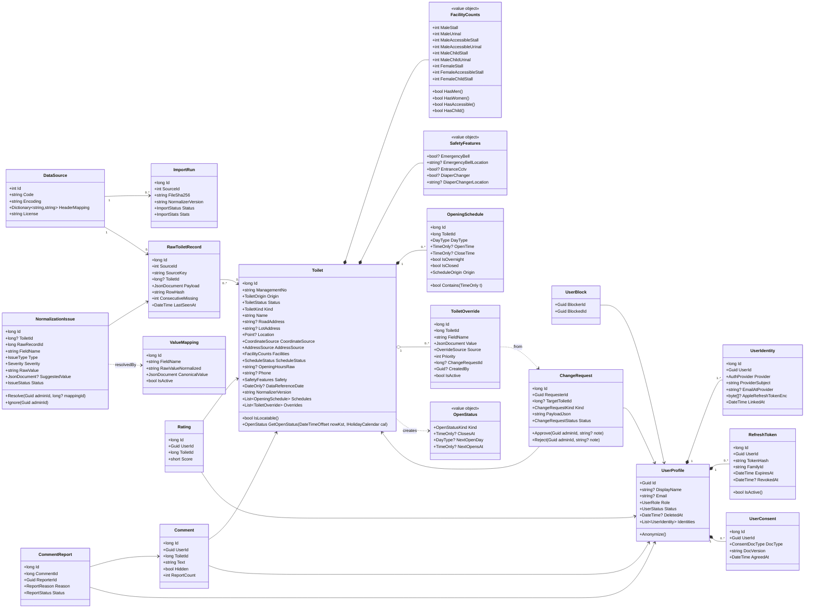
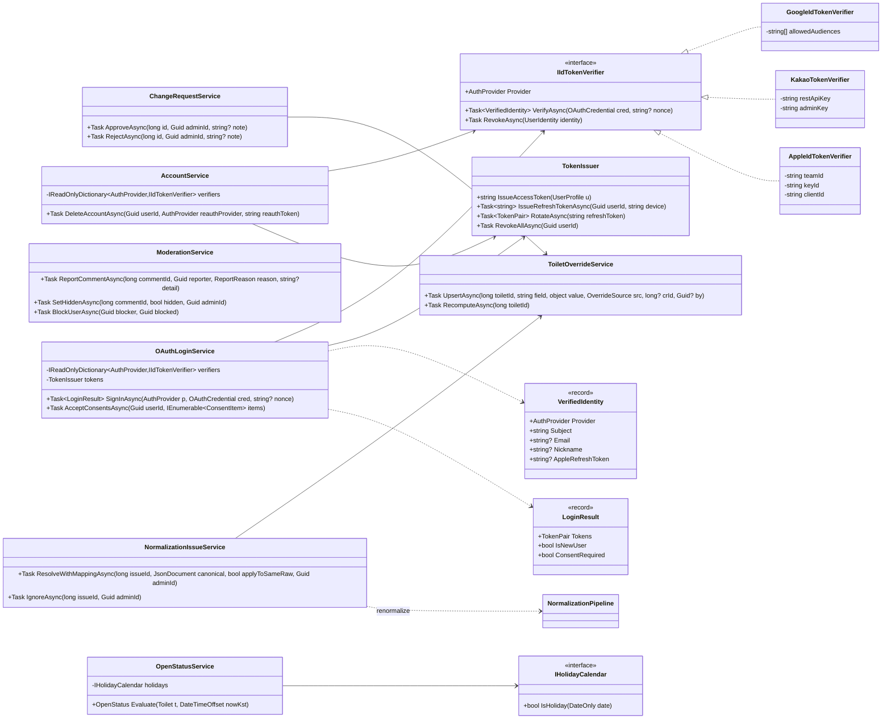
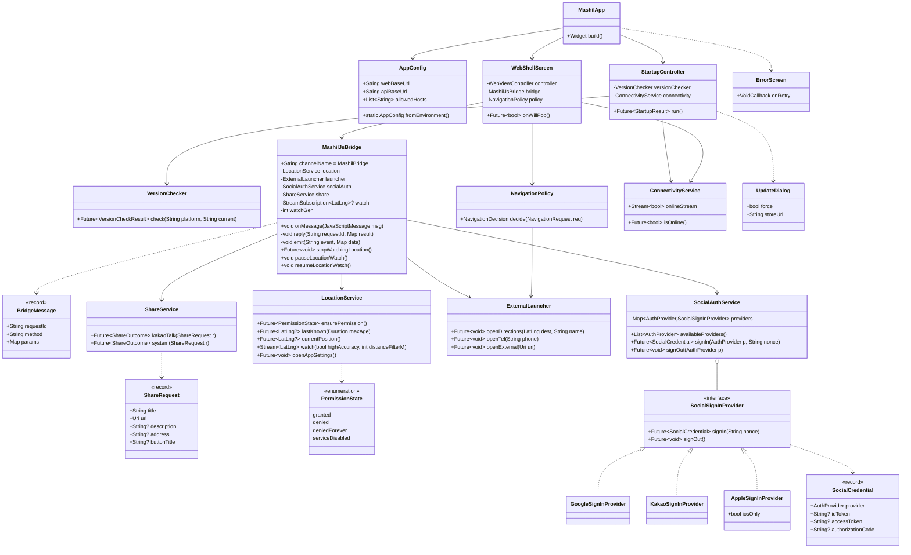

# 마실 클래스 다이어그램

세 영역으로 나눈다.

1. **도메인 모델** (`Mashil.Domain`): 엔티티와 값 객체
2. **정규화 파이프라인과 일일 갱신** (`Mashil.Import` 라이브러리 + `Mashil.Worker` 호스트): 기존 `tools/Mashil.CsvImport`를 확장하고 이름을 바꾼다. Worker는 API와 별도 프로세스로 실행한다 (OPS-01)
3. **Flutter 셸** (`mashil_app`)

---

## 1. 도메인 모델

### 1.1 열거형

```mermaid
classDiagram
    direction LR
    class ToiletKind {
        <<enumeration>>
        Public
        Open
        Mobile
        Temporary
        Other
    }
    class ToiletStatus {
        <<enumeration>>
        Active
        Missing
        Removed
    }
    class ToiletOrigin {
        <<enumeration>>
        PublicData
        UserSubmitted
    }
    class ScheduleStatus {
        <<enumeration>>
        AlwaysOpen
        Scheduled
        NotOpen
        Irregular
        FollowsFacility
        Unknown
    }
    class DayType {
        <<enumeration>>
        MON
        TUE
        WED
        THU
        FRI
        SAT
        SUN
        HOLIDAY
    }
    class OpenStatusKind {
        <<enumeration>>
        AlwaysOpen
        Open
        Closed
        Unknown
    }
    class OverrideSource {
        <<enumeration>>
        Geocode = 10
        ChangeRequest = 20
        Admin = 30
    }
    class IssueType {
        <<enumeration>>
        Unparsed
        Partial
        DurationOnly
        OutOfRange
        Swapped
        CoordinateMismatch
        UnknownCode
        InvalidPhone
        Conflict
        NoHours
        MissingSido
        GeocodeNoMatch
    }
    class ChangeRequestKind {
        <<enumeration>>
        Add
        Edit
        Delete
    }
    class ReportReason {
        <<enumeration>>
        Spam
        Abuse
        False
        Other
    }
    class AuthProvider {
        <<enumeration>>
        Google
        Kakao
        Apple
    }
    class ConsentDocType {
        <<enumeration>>
        Terms
        Privacy
        LocationTerms
    }
```

> `CoordinateSource`, `AddressSource`, `UserRole`, `ChangeRequestStatus`는 기존 정의를 유지한다.

---

## 2. 정규화 파이프라인 (`Mashil.Import`)

```mermaid
classDiagram
    direction TB

    class DailyImportJob {
        -ISourceFetcher fetcher
        -ImportLock importLock
        -ImportPreValidator validator
        -ImportRunner runner
        -IAlertNotifier alerts
        +string CronKst
        +Task ExecuteAsync(CancellationToken ct)
    }
    class ISourceFetcher {
        <<interface>>
        +Task~FetchedFile~ FetchAsync(DataSource src, CancellationToken ct)
    }
    class LocalDataFileFetcher {
        -HttpClient http
        -CookieContainer cookies
        -RetryPolicy retry
        -Task OpenSessionAsync()
        -Task~QuotaCheck~ CheckDownloadCountAsync()
        -Task~FetchedFile~ DownloadAsync()
    }
    class ManualUploadFetcher
    class QuotaCheck {
        <<record>>
        +bool Allowed
        +bool RateLimited
        +TimeSpan? RetryAfter
        +string? Message
    }
    class FetchedFile {
        <<record>>
        +string Path
        +long SizeBytes
        +string Sha256
        +string ContentType
    }
    class ImportLock {
        +Task~IAsyncDisposable?~ TryAcquireAsync(string sourceCode)
        +Task HeartbeatAsync(long runId)
        +Task ReapAbandonedAsync(TimeSpan staleAfter)
    }
    class ImportPreValidator {
        +Task~ValidationVerdict~ ValidateAsync(FetchedFile f, DataSource src, ImportRun? lastSuccess)
    }
    class ValidationVerdict {
        <<record>>
        +bool Accepted
        +string? Reason
        +int RowCount
        +double CorruptRatio
    }
    class IAlertNotifier {
        <<interface>>
        +Task NotifyAsync(AlertLevel level, string title, string body)
    }
    class MissingRecordProcessor {
        +int RemoveAfterMisses = 3
        +double MassRemovalThreshold = 0.01
        +Task~MissingOutcome~ ProcessAsync(ImportRun run)
    }

    class ImportRunner {
        -ISourceAdapterFactory adapters
        -NormalizationPipeline pipeline
        -ToiletMerger merger
        -MissingRecordProcessor missing
        -IImportRepository repo
        +Task~ImportRun~ RunAsync(string sourceCode, FetchedFile file, ImportTrigger trigger)
        +Task~ImportRun~ RenormalizeAsync(string sourceCode, string? fieldFilter)
    }

    DailyImportJob --> ISourceFetcher
    DailyImportJob --> ImportLock
    DailyImportJob --> ImportPreValidator
    DailyImportJob --> ImportRunner
    DailyImportJob --> IAlertNotifier
    ISourceFetcher <|.. LocalDataFileFetcher
    ISourceFetcher <|.. ManualUploadFetcher
    ISourceFetcher ..> FetchedFile
    LocalDataFileFetcher ..> QuotaCheck
    ImportPreValidator ..> ValidationVerdict
    ImportRunner --> MissingRecordProcessor

    class ISourceAdapter {
        <<interface>>
        +string SourceCode
        +IAsyncEnumerable~SourceRow~ ReadAsync(Stream file)
    }
    class PublicToiletStdCsvAdapter {
        +string SourceCode = PUBLIC_TOILET_STD
        +IAsyncEnumerable~SourceRow~ ReadAsync(Stream file)
    }
    class LocalGovOpenToiletAdapter {
        <<future>>
    }
    class SourceRow {
        <<record>>
        +string SourceKey
        +IReadOnlyDictionary~string,string?~ Fields
        +string ComputeHash()
    }

    class NormalizationPipeline {
        -IReadOnlyList~INormalizationStep~ steps
        +string Version
        +NormalizationResult Normalize(SourceRow row)
    }
    class INormalizationStep {
        <<interface>>
        +string FieldGroup
        +void Apply(SourceRow row, NormalizationContext ctx)
    }
    class NormalizationContext {
        +NormalizedToilet Draft
        +List~IssueDraft~ Issues
        +IValueMappingLookup Mappings
        +void AddIssue(string field, IssueType type, Severity sev, string raw, object? suggested)
    }
    class NormalizationResult {
        +NormalizedToilet Toilet
        +IReadOnlyList~IssueDraft~ Issues
        +IReadOnlyDictionary~string,bool~ FieldSuccess
    }

    class BasicFieldStep
    class KindStep
    class OpeningHoursStep {
        -OpeningHoursParser parser
    }
    class FacilityCountStep
    class YesNoStep
    class PhoneStep
    class CoordinateStep {
        +double LatMin = 33.0
        +double LatMax = 38.7
        +double LngMin = 124.5
        +double LngMax = 132.0
    }
    class AddressStep {
        -ISidoResolver sido
        +GeocodeQuery BuildQuery(string? road, string? lot, int localGovCode)
    }
    class GeocodeQuery {
        <<record>>
        +string Query
        +string? RoadName
        +string? LotDong
        +string MainNo
        +bool Matches(KakaoAddressDoc doc)
    }

    class OpeningHoursParser {
        -IReadOnlyList~IScheduleRule~ rules
        +ParseOutcome Parse(string? openHours, string? detail)
    }
    class IScheduleRule {
        <<interface>>
        +bool TryMatch(string text, ScheduleBuilder b)
    }
    class AlwaysOpenRule
    class TimeRangeRule
    class HourOnlyRangeRule
    class DayRangeRule
    class ClosedDayRule
    class HolidayRule
    class DurationOnlyRule
    class ScheduleBuilder {
        +SetAlwaysOpen()
        +AddSlot(DayType[] days, TimeOnly open, TimeOnly close)
        +MarkClosed(DayType[] days)
        +ParseOutcome Build()
    }
    class ParseOutcome {
        <<record>>
        +ScheduleStatus Status
        +IReadOnlyList~ScheduleSlot~ Slots
        +bool IsPartial
        +IssueType? Issue
    }

    class ToiletMerger {
        -OverrideResolver resolver
        +MergeOutcome Merge(NormalizedToilet draft, Toilet? existing)
    }
    class OverrideResolver {
        +object? Resolve(string field, object? normalized, IEnumerable~ToiletOverride~ overrides)
    }
    class IValueMappingLookup {
        <<interface>>
        +bool TryGet(string field, string raw, out JsonDocument value)
    }
    class ImportReportWriter {
        +void Write(ImportRun run, TextWriter output)
    }

    ImportRunner --> ISourceAdapter
    ImportRunner --> NormalizationPipeline
    ImportRunner --> ToiletMerger
    ImportRunner ..> ImportReportWriter
    ISourceAdapter <|.. PublicToiletStdCsvAdapter
    ISourceAdapter <|.. LocalGovOpenToiletAdapter
    ISourceAdapter ..> SourceRow : yields
    NormalizationPipeline o-- INormalizationStep
    NormalizationPipeline ..> NormalizationContext
    NormalizationPipeline ..> NormalizationResult
    INormalizationStep <|.. BasicFieldStep
    INormalizationStep <|.. KindStep
    INormalizationStep <|.. OpeningHoursStep
    INormalizationStep <|.. FacilityCountStep
    INormalizationStep <|.. YesNoStep
    INormalizationStep <|.. PhoneStep
    INormalizationStep <|.. CoordinateStep
    INormalizationStep <|.. AddressStep
    NormalizationContext --> IValueMappingLookup
    OpeningHoursStep --> OpeningHoursParser
    AddressStep ..> GeocodeQuery
    OpeningHoursParser o-- IScheduleRule
    OpeningHoursParser ..> ScheduleBuilder
    ScheduleBuilder ..> ParseOutcome
    IScheduleRule <|.. AlwaysOpenRule
    IScheduleRule <|.. TimeRangeRule
    IScheduleRule <|.. HourOnlyRangeRule
    IScheduleRule <|.. DayRangeRule
    IScheduleRule <|.. ClosedDayRule
    IScheduleRule <|.. HolidayRule
    IScheduleRule <|.. DurationOnlyRule
    ToiletMerger --> OverrideResolver
```

**설계 포인트**

- 각 `INormalizationStep`은 서로 독립적인 필드 그룹만 다룬다. 스텝을 추가해도 다른 스텝에 영향이 없다.
- `OpeningHoursParser`는 먼저 `IValueMappingLookup`(관리자 사전)을 조회하고, 매칭되지 않으면 규칙 체인을 적용한다. 매핑이 규칙보다 우선한다.
- 파서는 순수 함수다 (DB 접근 없음). `원본 문자열 → ParseOutcome` 회귀 코퍼스로 단위 테스트한다 (NFR-12).
- `DailyImportJob`은 `Mashil.Worker`의 호스티드 서비스로 실행하고, 같은 Worker에서 `GeocodeWorker`도 돌린다. API에서는 관리자 수동 업로드만 받아 `ManualUploadFetcher` 경로로 Worker에 넘긴다 (작업 큐 테이블 또는 `import_runs(status=Queued)`).
- `NormalizationPipeline.Version`은 규칙이 바뀔 때 올린다. `toilets.normalizer_version`이 이 값보다 낮으면 재정규화 대상이다.

---

## 3. 승인 반영 서비스 (`Mashil.Api`)

**토큰 검증 방식**

| Verifier | 검증 | 탈퇴 시 연결 해제 |
|---|---|---|
| Google | ID Token의 JWKS 서명, `iss`, `aud`(iOS, Android, Web 클라이언트 ID 목록), `exp`, `nonce` | `oauth2.googleapis.com/revoke` (선택) |
| Kakao | OIDC를 켜면 ID Token을 JWKS로 검증. 끄면 `access_token_info`로 앱 ID를 확인한 뒤 사용자 정보 조회 | `v1/user/unlink` (Admin 키) |
| Apple | ID Token의 JWKS 서명, `iss=https://appleid.apple.com`, `aud`, `nonce`(SHA-256). `authorization_code`를 교환해서 refresh token을 암호화 저장 | `auth/revoke` (필수) |

---

## 4. Flutter 셸 (`mashil_app`)

**JS 브리지 프로토콜 (요약)**

| method | params | 응답 |
|---|---|---|
| `getLocation` | `{ maximumAgeMs?, highAccuracy?, timeoutMs? }` | `{ ok, lat, lng, accuracy, cached }` 또는 `{ ok:false, reason:"denied"\|"deniedForever"\|"serviceDisabled"\|"timeout" }`. `maximumAgeMs` 안의 마지막 위치가 있으면 새로 재지 않고 바로 준다 (`cached: true`). 파라미터가 없으면 정밀 측정, 12초까지 |
| `openSettings` | — | `{ ok }` |
| `openDirections` | `{ lat, lng, name, mode?: "walk"\|"car" }` | `{ ok, app:"kakaomap"\|"web" }`. 카카오맵 앱 `by=FOOT` / `by=CAR` (mode 가 없으면 도보) |
| `getAppInfo` | — | `{ version, platform, providers:["google","kakao","apple"] }` (웹에서 앱 여부와 노출할 로그인 버튼 판별) |
| `signIn` | `{ provider, nonce }` | `{ ok, provider, idToken?, accessToken?, authorizationCode? }` 또는 `{ ok:false, reason:"cancelled"\|"failed" }` |
| `signOut` | `{ provider }` | `{ ok }` |
| `watchLocation` | `{ highAccuracy?, distanceFilterM? }` (기본 true, 3m) | `{ ok }` 또는 `{ ok:false, reason }` (getLocation 과 같은 사유). 이후 위치가 바뀔 때마다 `location` 이벤트. 방향 안내 화면에서만 쓴다 |
| `stopWatchLocation` | — | `{ ok }` |
| `share` | `{ target:"kakao"\|"system", title, url, description?, address?, buttonTitle? }` | `{ ok, via:"kakaoTalk"\|"kakaoWeb"\|"shared" }` 또는 `{ ok:false, reason:"dismissed"\|"invalidParams"\|"failed" }`. `kakao` 는 카카오톡 위치 카드(주소가 있으면 "위치 보기" 버튼), 카카오톡이 없으면 카카오 웹 공유. `system` 은 시스템 공유 창. `url` 은 허용 호스트만 |

- 웹에서 앱으로: `window.MashilBridge.postMessage(JSON.stringify({requestId, method, params}))`
- 앱에서 웹으로: `controller.runJavaScript("window.__mashilBridgeReply(requestId, result)")`
- 앱에서 웹으로 이벤트 (요청 없이 앱이 먼저): `window.__mashilBridgeEvent(name, data)`
  - `location`: `{ lat, lng, accuracy, heading? }`
  - `locationError`: `{ reason }`. 이 뒤로는 이벤트가 오지 않는다
  - 셸은 문서를 새로 부르면(onPageStarted) 구독을 끊고, 앱이 화면에서 내려가면 쉬었다가 돌아오면 같은 설정으로 다시 붙인다. 백그라운드 위치는 쓰지 않는다 (STO-06)
- 웹 측에 `src/lib/nativeBridge.ts`를 추가한다. 브리지가 없으면 `navigator.geolocation`으로 폴백한다.

**권장 패키지:** `webview_flutter`, `geolocator`, `permission_handler`, `url_launcher`, `connectivity_plus`, `package_info_plus`, `google_sign_in`, `kakao_flutter_sdk_user`, `sign_in_with_apple`
