# 마실 시퀀스 다이어그램

| # | 시나리오 | 관련 요구사항 |
|---|---|---|
| SD-01 | 앱 시작과 버전 체크 | APP-01, APP-06, APP-09 |
| SD-02 | 위치 브리지와 근접 검색 | APP-02, APP-03, MAP-01, MAP-05 |
| SD-03 | 외부 길찾기 | APP-04, APP-07 |
| SD-04 | 데이터 임포트와 정규화 | DATA-01~16 |
| SD-05 | 정규화 이슈 검수 (매핑 사전 등록) | DATA-12, DATA-13, ADM-03 |
| SD-06 | 변경 요청 승인 반영 | CR-03, DATA-11 |
| SD-07 | 댓글 신고와 사용자 차단 | UGC-02~05 |
| SD-08 | 계정 삭제 (IdP 재인증, 연결 해제) | USR-03 |
| SD-09 | OAuth 로그인·자동 가입 (앱) | USR-01, USR-02, APP-12, STO-04 |
| SD-10 | OAuth 로그인 (일반 웹 브라우저) | USR-04 |
| SD-11 | 토큰 갱신 (Refresh 회전) | USR-02, NFR-05 |
| SD-12 | 일일 자동 갱신 (다운로드, 사전 검증, 무중단 반영) | DATA-15, DATA-18~23 |
| SD-13 | 무중단 배포 | OPS-01~04, OPS-06 |
| SD-14 | 점검 모드 | OPS-05, ADM-06 |

> SD-04는 정규화 처리 자체(행 단위)를 보여주고, SD-12는 그 바깥의 일일 실행 흐름(락, 다운로드, 검증, 누락 처리, 알림)을 보여준다.

---

## SD-01. 앱 시작과 버전 체크

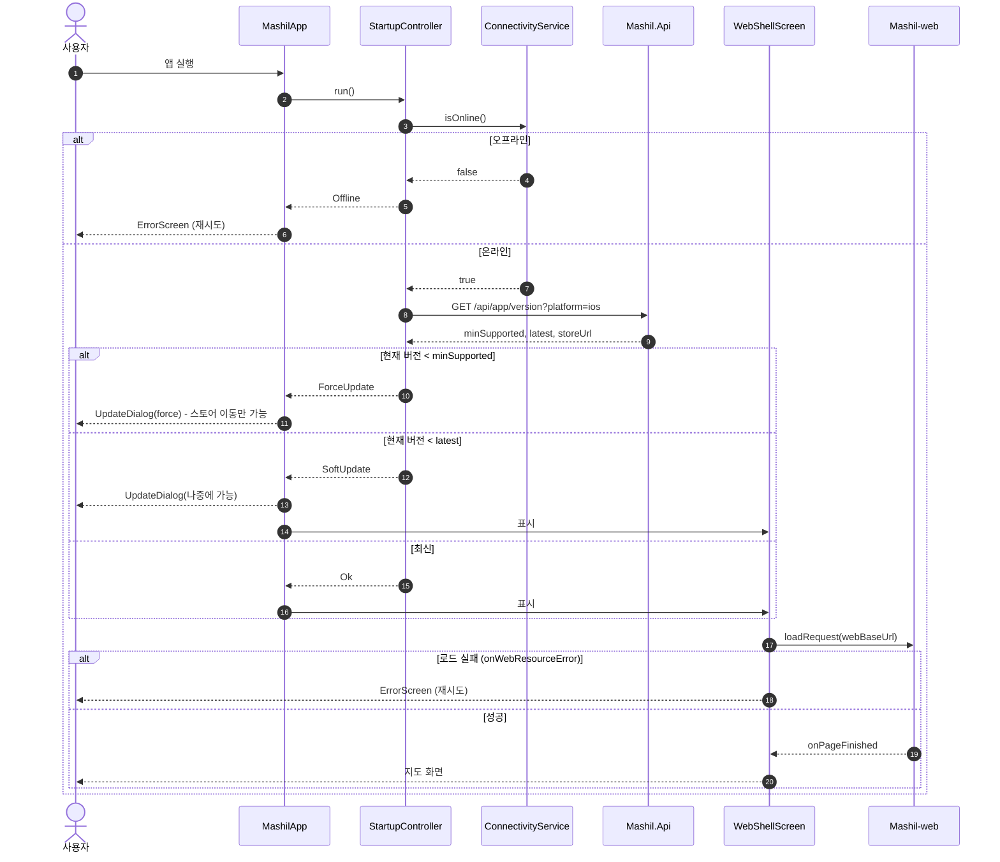

## SD-02. 위치 브리지와 근접 검색

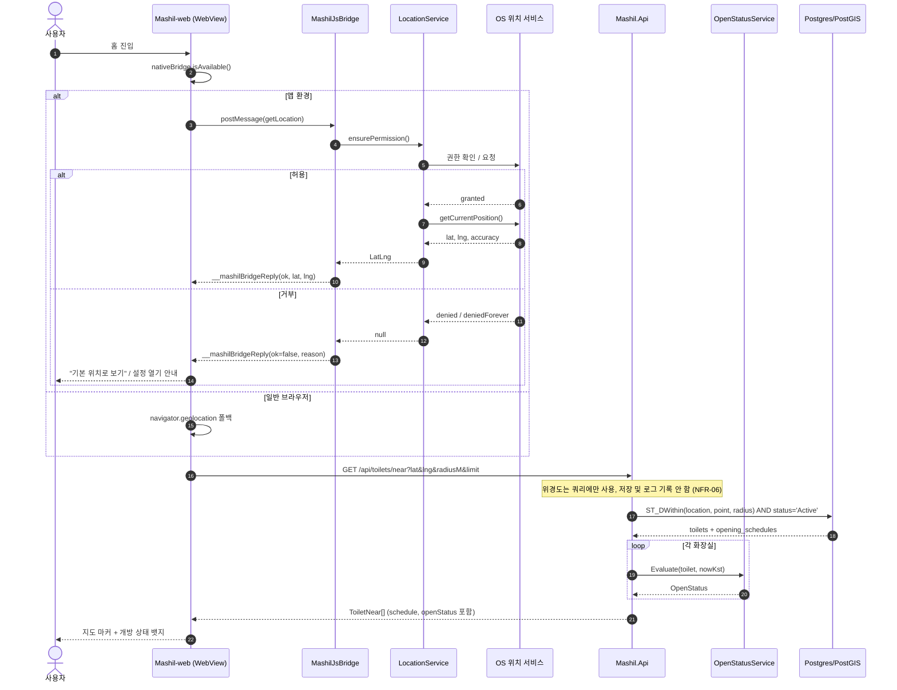

## SD-03. 외부 길찾기

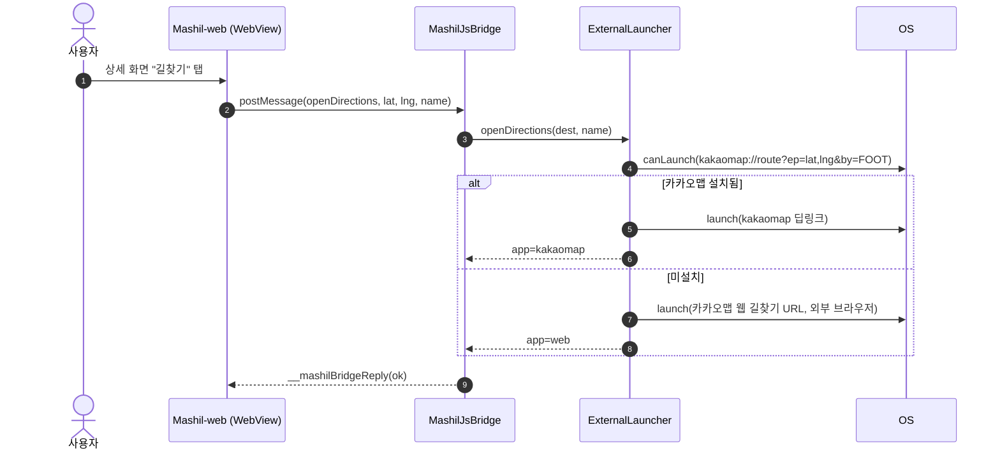

## SD-04. 데이터 임포트와 정규화

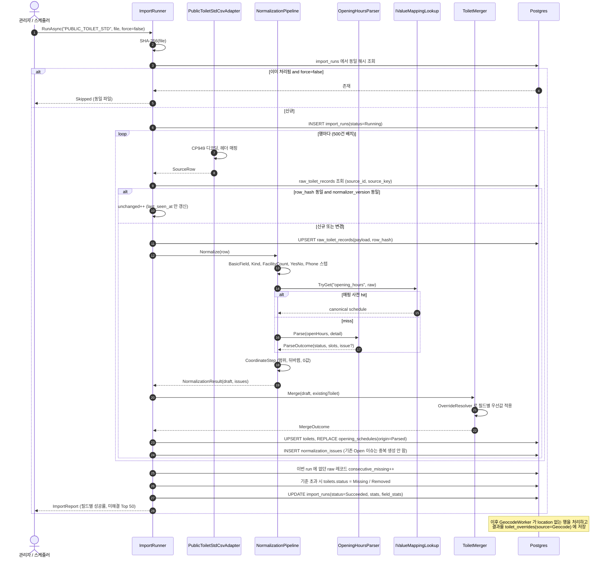

## SD-05. 정규화 이슈 검수 (매핑 사전 등록)

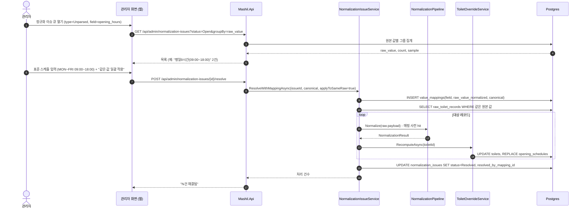

## SD-06. 변경 요청 승인 반영

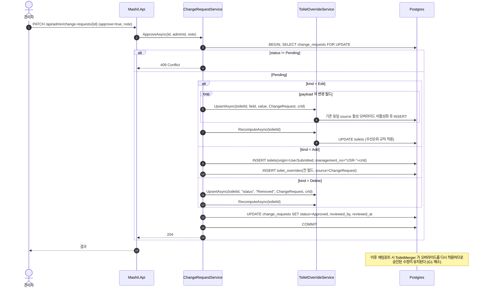

## SD-07. 댓글 신고와 사용자 차단

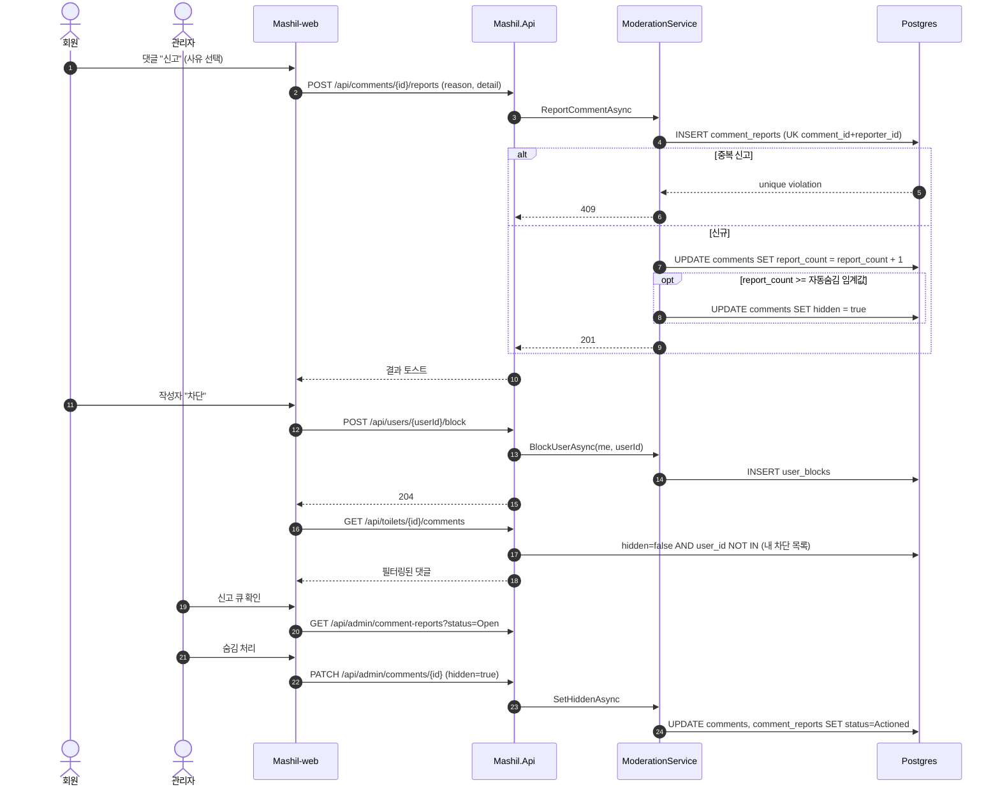

## SD-08. 계정 삭제

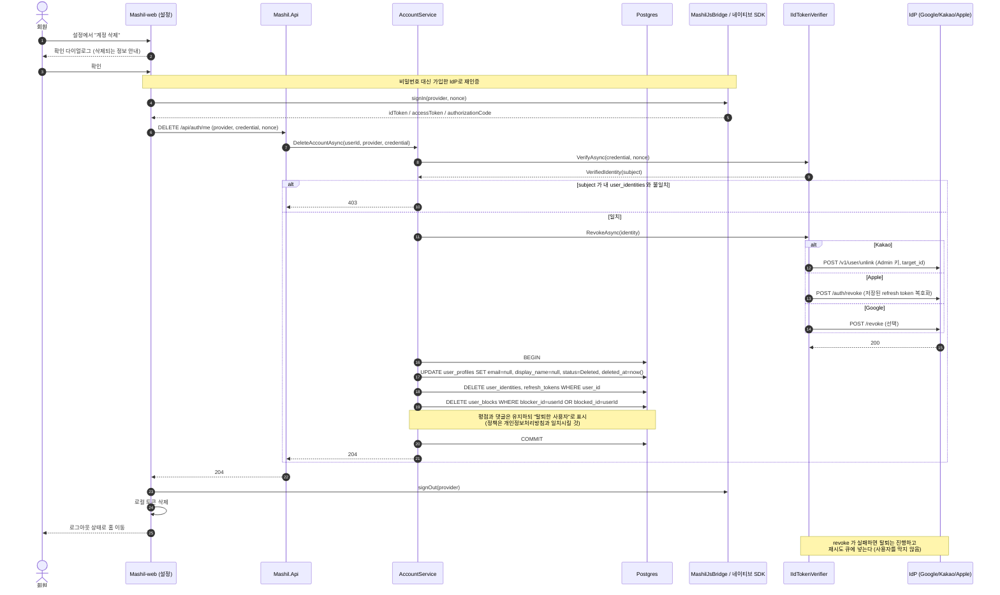

## SD-09. OAuth 로그인·자동 가입 (앱)

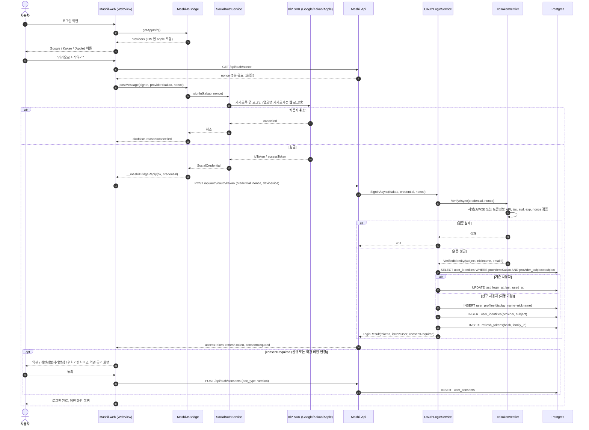

## SD-10. OAuth 로그인 (일반 웹 브라우저)

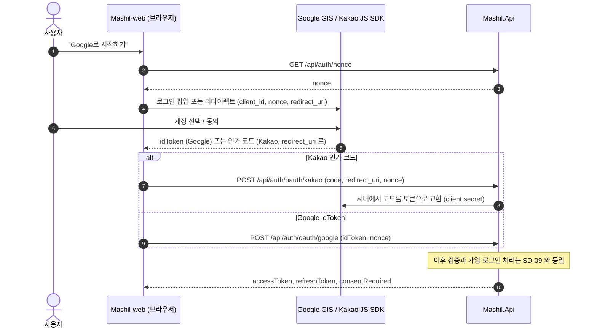

## SD-11. 토큰 갱신 (Refresh 회전)

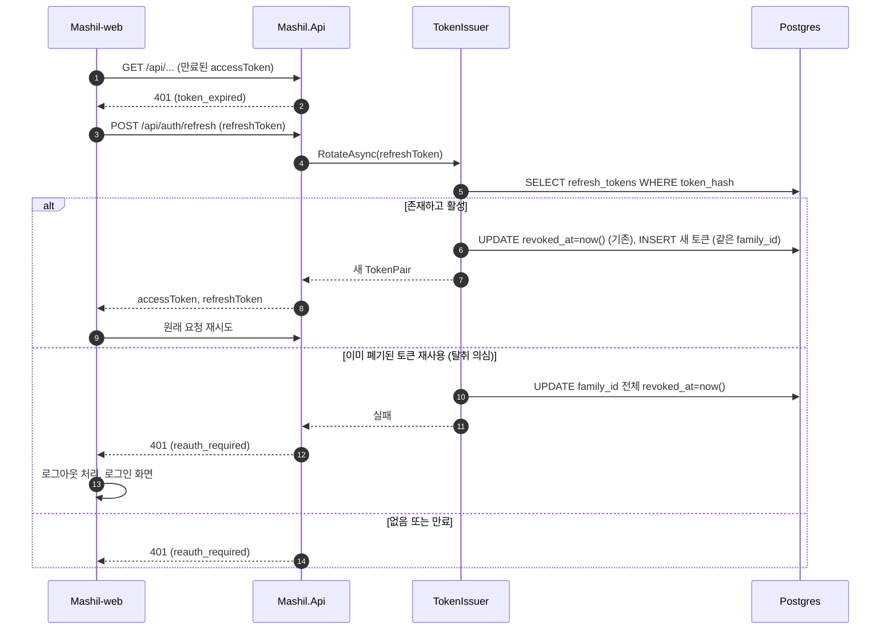

## SD-12. 일일 자동 갱신

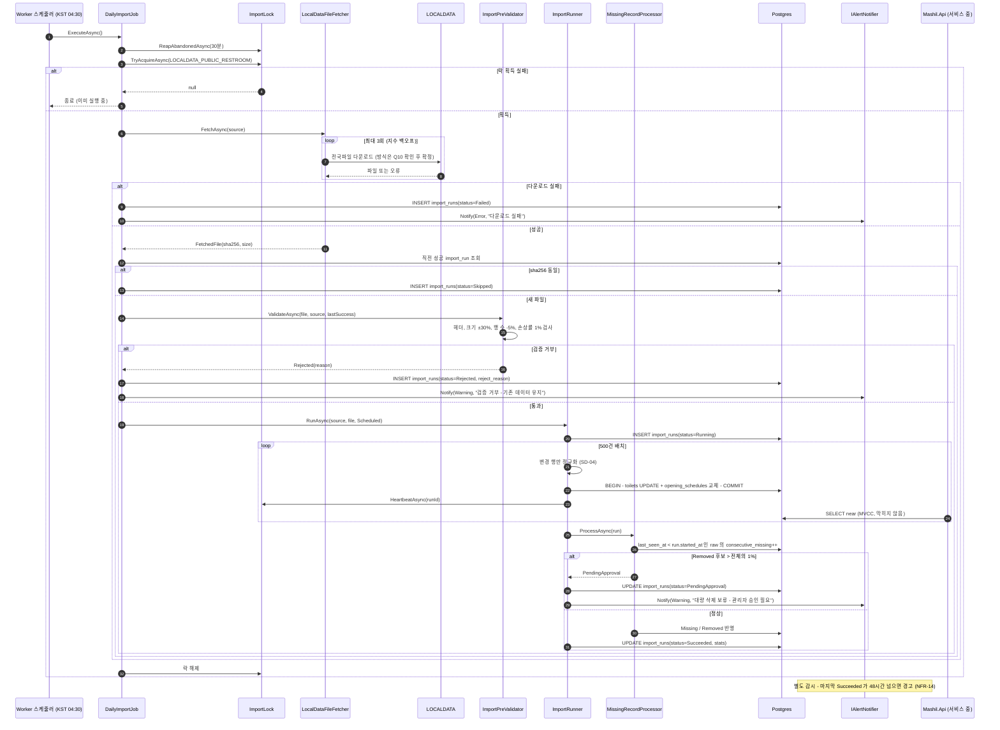

## SD-13. 무중단 배포

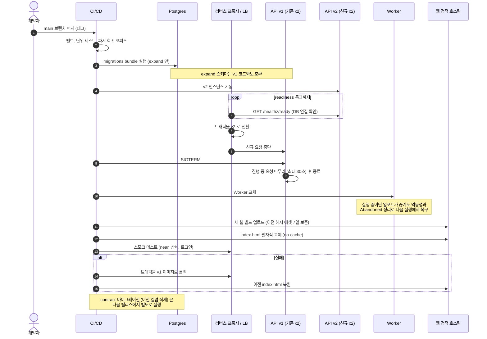

## SD-14. 점검 모드

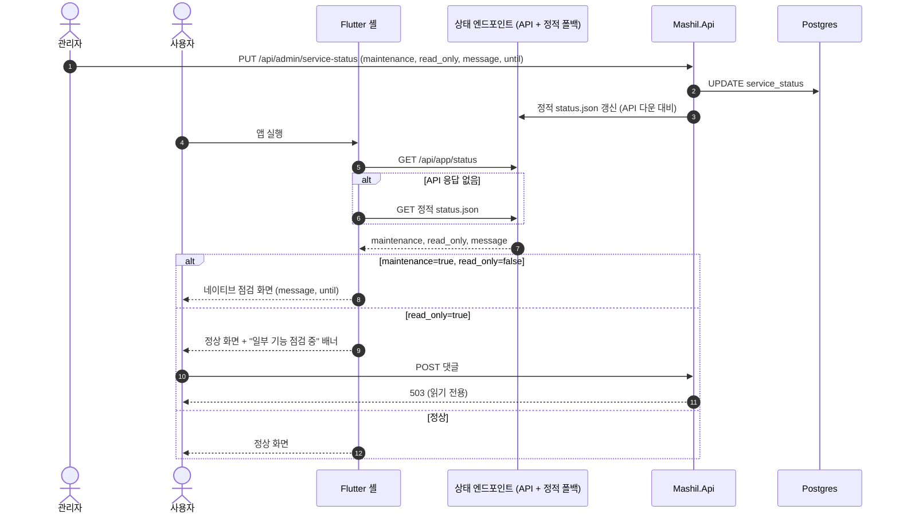
