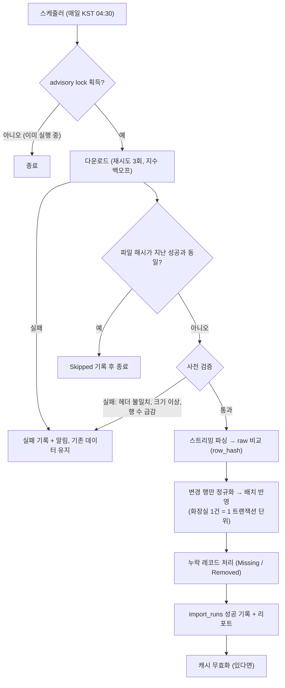

# 마실 운영 설계: 일일 데이터 갱신과 무중단 배포

| 항목 | 내용 |
|---|---|
| 작성일 | 2026-11-14 |
| 관련 요구사항 | DATA-18~23, NFR-13~16, OPS-01~06 ([01-requirements.md](01-requirements.md)) |
| 관련 다이어그램 | SD-12, SD-13, SD-14 ([04-sequence-diagrams.md](04-sequence-diagrams.md)) |

## 1. 결론

| 질문 | 답 | 조건 |
|---|---|---|
| 하루 한 번 갱신하려면 점검 시간이 필요한가? | **필요 없다** | 변경분만 짧은 트랜잭션으로 반영하고, 화장실 1건 단위로 원자적으로 교체하고, 검증에 실패하면 반영하지 않는다 (§2) |
| API를 무중단으로 배포할 수 있는가? | **가능하다** | 인스턴스 2개 이상 + 헬스체크 기반 교체. 임포트는 API 프로세스에서 분리. DB 스키마 변경은 확장·축소(expand/contract) 방식 (§3) |
| 점검 시간이 꼭 필요한 경우는? | **드물게 있다** | Postgres·PostGIS 메이저 업그레이드, 호스팅 이전, 파괴적 스키마 변경을 한 번에 할 때. 앱에 점검 모드 화면을 준비해 둔다 (§4) |

---

## 2. 일일 갱신 파이프라인

### 2.1 데이터 소스

- 출처: LOCALDATA 공중화장실정보 **전국파일** (`https://file.localdata.go.kr/file/public_restroom_info/info`)
- **다운로드 URL (2026-11-14 페이지 소스에서 확인):** 버튼의 `data-download-urls` 값은 `/file/download/public_restroom_info/info`, 즉 `https://file.localdata.go.kr/file/download/public_restroom_info/info`이다.
  - 이 환경(브라우저 세션 없음)에서 직접 요청하면 `302 → /error.html`이 돌아왔다. 페이지 세션 쿠키, Referer, 국내 IP 중 하나가 필요한 것으로 보인다.
  - **브라우저 실측 (2026-11-14):** 다운로드 버튼을 누르면 먼저 `GET /file/validate/download-count`(XHR, same-origin)가 호출된다.
    - 요청에 쓰이는 것: 쿠키 `XSRF-TOKEN`(Spring Security CSRF 쿠키로 보임), `WMONID`(WebtoB/JEUS 세션 추적 쿠키), `Referer: .../file/public_restroom_info/info`
    - 응답 판정은 **상태 코드만으로** 한다 (사이트 JS `validateDownloadCount()`로 확인됨. 본문은 429일 때 메시지로만 쓰임)
      - `200`: 다운로드 허용
      - `429`: 요청 과다. 본문은 안내 문구 (없으면 "잠시후 시도해주세요.")
      - 그 외: 오류
    - 문구로 보아 일일 할당량보다는 **짧은 주기의 요청 빈도 제한(throttle)**에 가깝다. 다만 제한 기준(시간 창, IP 또는 쿠키 기준)은 미확인이다
  - 구현 방향: `LocalDataFileFetcher`는 브라우저와 같은 순서로 요청한다.
    1. `GET /file/public_restroom_info/info`: `Set-Cookie`로 `XSRF-TOKEN`, `WMONID` **두 개만** 받는다 (확인됨. `JSESSIONID` 같은 서버 세션 쿠키 없음). 쿠키는 매 실행마다 새로 받고 저장하지 않는다
       - 서버 세션이 없으므로 CSRF는 Spring `CookieCsrfTokenRepository`의 double-submit 방식으로 추정한다. 즉 서버는 쿠키 `XSRF-TOKEN` 값과 헤더 `X-XSRF-TOKEN` 값이 같은지만 비교한다. 상태를 바꾸는 요청(POST 등)에는 이 헤더를 붙인다
       - `WMONID`는 WebtoB 모니터링용이라 인증에는 쓰이지 않을 가능성이 크다. 그래도 브라우저와 동일하게 쿠키 컨테이너로 그대로 돌려보낸다
    2. `GET /file/validate/download-count` (쿠키 + Referer)
       - `200`: 3단계로 진행
       - `429`: **다운로드 요청을 보내지 않는다.** `Retry-After` 헤더가 있으면 그 시간만큼, 없으면 15분 → 30분 → 60분 간격으로 최대 3회 다시 검사한다. 끝내 429면 `Failed(RateLimited)`로 기록하고 응답 본문 문구를 담아 알림을 보낸 뒤 다음 날 정기 실행을 기다린다
       - 그 외 4xx/5xx, 네트워크 오류: 일반 재시도 정책 (지수 백오프 3회)을 적용하고, 실패하면 알림을 보낸다
    3. `/file/download/public_restroom_info/info`: **`Referer: https://file.localdata.go.kr/file/public_restroom_info/info`가 붙는다 (확인됨)**. 서버가 Referer를 검사할 가능성이 있으므로 HttpClient에서 명시적으로 설정한다 (브라우저와 달리 자동으로 붙지 않음). 메서드는 **GET (확인됨)**이므로 `X-XSRF-TOKEN` 헤더는 필요 없다
       - **요청 실측 (2026-11-14):** 쿼리 파라미터, `Range`, `X-XSRF-TOKEN` 모두 없다. 쿠키는 `download-count`와 **같은 값**(`XSRF-TOKEN`, `WMONID`)을 쓴다. `Sec-Fetch-Dest: iframe`, `Sec-Fetch-Mode: navigate`인 것으로 보아 사이트는 숨은 iframe으로 다운로드를 시작한다
       - 다운로더가 보낼 헤더 (최소 구성부터 시작):

         | 헤더 | 값 | 비고 |
         |---|---|---|
         | `Cookie` | 1단계에서 받은 `XSRF-TOKEN`, `WMONID` | `CookieContainer`로 자동 처리 |
         | `Referer` | `https://file.localdata.go.kr/file/public_restroom_info/info` | 명시적으로 설정 |
         | `Accept` | `text/csv,*/*;q=0.8` | |
         | `Accept-Encoding` | `gzip, deflate, br` | `HttpClientHandler.AutomaticDecompression = All` |
         | `User-Agent` | 서비스명과 연락 경로를 밝히는 값 | 브라우저 위장은 하지 않음 |

       - **변경 (2026-11-14):** 최소 구성(서비스 UA)으로 요청하니 정보 페이지에서부터 `302 → /error.html`로 막혔다. 결정에 따라 **브라우저와 같은 헤더**(Chrome UA, Accept, `Sec-Fetch-*`, `sec-ch-ua`)로 요청하는 옵션 `Import:LocalData:BrowserHeaders`를 추가하고 기본으로 켰다. 요청은 하루 1회, 3건(페이지 → 확인 → 다운로드)으로 유지한다
       - **해결 (2026-11-14):** 정보 페이지는 **직접 접속하면 실제 브라우저(시크릿 창)에서도 302**다. 공공데이터포털 표준데이터 페이지(`https://www.data.go.kr/data/15012892/standard.do`)에서 넘어와야 열린다. 다운로더가 정보 페이지 요청에 이 포털 페이지를 `Referer`로 붙이도록 했고(`Import:LocalData:EntryReferer`), **서비스 UA 그대로, 브라우저 헤더 없이** 다운로드에 성공했다. run #8: 53,581행, 신규 2 / 변경 3 / 동일 53,576, 21초. 브라우저 헤더 옵션은 꺼 둔 채 대비용으로 남긴다
       - 이전 시도 기록 (2026-11-14): 브라우저 헤더로도 정보 페이지에서 똑같이 `302 → /error.html`. 같은 PC의 브라우저로는 받아지므로 IP 문제는 아니고, 헤더 외 기준(TLS 지문, JS 실행 등)으로 거르는 것으로 보인다. 더 깊은 우회는 하지 않기로 하고 옵션을 다시 껐다. **현재 자동 다운로드는 불가**하다. 일일 작업은 실패 알림을 보내고, 데이터는 수동 업로드로 갱신한다. 대안은 공식 OpenAPI 전환이다 (Q14)
       - **위험 (옵션을 다시 켤 경우):** 사이트가 자동 요청을 의도적으로 막는 것으로 보이므로 이용 조건 위반 소지가 있고, 사이트가 차단 방식을 바꾸면 언제든 다시 막힌다. 막히면 알림(DATA-21)이 오고 수동 업로드로 운영한다. 공식 자동 수집 경로(공공데이터포털 OpenAPI 등)를 계속 확인하고, 확보되면 이 옵션을 끈다 (LEG-04)
       - 앞서 세션 없이 요청했을 때 `302 → /error.html`이 돌아온 것은 쿠키나 Referer가 없었기 때문으로 추정한다. **P0에서 운영 서버로 최소 구성 요청을 시험해 확정한다**
       - **응답 실측 (2026-11-14):** `200`, `Content-Type: text/csv;charset=UTF-8`, `Content-Disposition: attachment; filename*=UTF-8''공중화장실정보.csv`, `Content-Length: 16122416` (약 15.4 MB), `Accept-Ranges: bytes`, `no-store`
         - 형식은 **CSV 단일 파일**이다 (압축 없음)
         - 인코딩: 헤더는 UTF-8이라고 선언하지만 **실제 바이트는 CP949**다 (2026-11-14 받은 파일로 확인, G11). 헤더 선언은 무시하고 아래처럼 판별한다
         - 행 수: **53,579행** (P0 확인, [06-data-profile.md](06-data-profile.md))
         - **좌표 컬럼이 없다.** 전량 지오코딩이 필요하다 (DATA-10, DATA-25)
         - `Accept-Ranges: bytes`가 있으므로 끊기면 `Range` 요청으로 이어 받을 수 있다. 15 MB 수준이라 처음부터 다시 받아도 무방하다
         - 사전 검증: `Content-Length`와 실제 받은 바이트 수가 같아야 하고, 직전 성공 대비 ±30% 안이어야 한다 (기준값 약 16.1 MB)
       - **형식은 헤더를 믿지 않고 내용으로 판별한다.** 응답 헤더에 `Content-Type`이나 `Content-Disposition`이 없을 수 있다. 첫 바이트를 확인해서 `PK\x03\x04`면 ZIP 컨테이너(XLSX 또는 ZIP. 내부 `[Content_Types].xml`로 구분), `<`로 시작하면 HTML 오류 페이지로 보고 실패 처리, 그 외에는 CSV 텍스트로 본다 (BOM이나 디코딩 시험으로 UTF-8과 CP949 판별): `Content-Disposition`의 파일명, `Content-Type`, 크기를 기록하고 스트리밍으로 저장한다
    4. 응답이 `302 → /error.html`이거나 HTML이면 실패로 처리하고 알림을 보낸다 (DATA-19, DATA-21)
  - **요청 횟수:** 하루 1회만 받고, 실패해도 재시도는 최대 3회(백오프)로 제한한다. 제한에 걸리면 다음 날까지 기다린다. 해시가 같으면 skip하는 것과 별개로 **다운로드 자체를 아끼는** 정책이다.
  - **User-Agent:** 브라우저인 척하지 않고 서비스명을 밝히는 UA를 쓰는 것을 기본으로 한다. 차단되면 LOCALDATA 이용 조건을 확인하거나 자동 수집 방법을 문의한다 (LEG-04).
  - **운영 서버에서 실제로 받아지는지 반드시 시험한다.** 받아지지 않으면 수동 업로드로 운영하면서 LOCALDATA에 자동 수집 방법을 문의한다.
- **아직 확인되지 않은 사항 (Q10):**
  - ~~`validate/download-count` 응답 형식~~ → 확인됨 (200 허용 / 429 제한 / 그 외 오류). 제한 기준(시간 창, IP 또는 쿠키 기준)은 미확인
  - ~~실제 파일 요청의 메서드와 응답 헤더~~ → 확인됨 (GET, CSV, UTF-8 선언, 약 15.4 MB)
  - 실제 바이트의 인코딩 (BOM 유무, 헤더의 UTF-8 선언이 맞는지)
  - 파일 형식 (CSV, XLSX, ZIP)과 인코딩
  - 원본 갱신 시각 (하루 중 언제 새 파일이 올라오는지)
  - 변동분(일 단위 증분) 파일 제공 여부
  - 이용 조건 (출처 표시 방식, 자동 수집 허용 여부)
- **확인 방법:** 브라우저 개발자도구 Network 탭에서 "전국파일 다운로드"를 누르고, 해당 요청의 URL, 메서드, 헤더, 응답 형식을 기록한다.
- **서버 위치 주의:** 운영 서버가 해외 리전에 있으면 같은 이유로 차단될 수 있다. **국내 리전 호스팅을 권장**하고, 배포 전에 운영 서버에서 다운로드를 시험한다 (Q11).
- 기존 `tools/Mashil.CsvImport`의 컬럼 매핑(`개방자치단체코드`, `관리번호`, ...)이 이 파일 형식과 일치하는지 P0에서 확인한다.

### 2.2 처리 단계와 안전장치

| 안전장치 | 내용 | 이유 |
|---|---|---|
| **사전 검증 (DATA-20)** | ① 필수 헤더 전부 존재 ② 파일 크기가 직전 성공 대비 ±30% 이내 ③ 파싱한 행 수가 직전 성공 대비 **-5% 이상 감소하지 않음** ④ 손상 행 비율 1% 미만. 하나라도 실패하면 DB에 쓰지 않고 중단한다 | 원본 사이트 장애로 빈 파일이나 일부만 담긴 파일이 오면 전국 화장실이 Missing 처리될 수 있음 |
| 누락 처리 지연 (DATA-15) | 검증을 통과한 **전체 성공 실행에서만** `consecutive_missing`을 올린다. 3회 연속 누락되면 Removed | 일시적 누락으로 지도에서 사라지는 것을 방지 |
| 대량 삭제 차단 | 한 번에 Removed로 바뀌는 건수가 전체의 1%를 넘으면 반영을 보류하고 관리자 승인을 기다린다 | 원본의 대규모 정정이나 오류에 대비 |
| 중복 실행 방지 | `pg_try_advisory_lock(<import key>)` | 인스턴스가 여러 개거나 수동 실행과 겹치는 경우 |
| 멱등성 | 관리번호 기준 upsert와 `row_hash` 비교. 중간에 끊겨도 처음부터 다시 실행하면 같은 결과 | 배포나 장애로 중단되는 경우 (§3.2) |
| 중단 실행 정리 | `status = Running`인데 heartbeat가 30분 넘게 끊긴 실행은 `Abandoned`로 바꾸고 다음 실행을 허용한다 | 프로세스가 죽은 경우 |
| 실패 알림 (DATA-21) | 실패, 검증 거부, 대량 삭제 보류가 생기면 관리자에게 알림 (이메일, 슬랙 웹훅 등) | — |
| 신선도 감시 (NFR-14) | 마지막 성공이 48시간을 넘으면 경고 | 조용한 실패 탐지 |

### 2.3 서비스 무영향의 근거

- **PostgreSQL MVCC:** 읽기는 쓰기에 막히지 않는다. 임포트 중에도 `/api/toilets/near`는 직전 커밋 상태를 읽는다.
- **변경분만 쓰기:** 매일 바뀌는 행은 전체의 일부일 것으로 예상한다 (P0에서 이틀 치 파일을 비교해 실측). `row_hash`가 같으면 `last_seen_at`만 갱신하고, 이 갱신도 배치 UPDATE 1회로 처리한다.
- **원자적 교체:** `toilets` UPDATE와 `opening_schedules` DELETE+INSERT를 **같은 트랜잭션**에서 처리한다. 화장실 하나가 "스케줄 없는 상태"로 보이는 순간이 없다.
- **짧은 트랜잭션:** 500건 배치당 1 트랜잭션으로, 각각 수백 ms 이내. 긴 락을 잡지 않는다.
- **GIST 인덱스:** 행 단위로 증분 갱신되므로 재구축이 필요 없다.
- **실행 시각:** 이용량이 적은 KST 04:30 (원본 갱신 시각 확인 후 조정, Q10).

### 2.4 전체 재정규화 (정규화 버전 업)

약 5~6만 건 전체를 다시 쓰는 작업도 **같은 배치 방식으로 무중단 처리**한다. 이 규모면 섀도 테이블 교체는 필요 없다. 다만 다음을 지킨다.

- 새벽 시간대에 실행하고, 배치 사이에 짧게 대기(예: 50ms)해서 DB 부하를 평탄화한다.
- 재정규화가 끝나기 전까지는 신·구 버전 결과가 섞여 있다. 레코드 하나하나는 일관되므로 서비스에 문제가 없다.
- 끝나면 `VACUUM (ANALYZE) toilets, opening_schedules`를 실행한다.

### 2.5 실행 위치

| 방식 | 장점 | 단점 | 권장 |
|---|---|---|---|
| API 프로세스 안의 BackgroundService (현재 GeocodeWorker 방식) | 구성이 단순함 | 배포할 때마다 작업이 끊기고, 인스턴스가 여러 개면 중복 실행됨 (lock으로 방지 가능) | ✗ |
| **별도 Worker 프로세스** (`Mashil.Worker`: 임포트 + 지오코딩) | API 배포와 독립적이고 리소스가 분리됨 | 배포 단위가 하나 늘어남 | **✓** |
| 외부 스케줄러가 실행하는 일회성 Job (cron, Cloud Scheduler + Job) | 실행할 때만 자원을 씀 | 플랫폼에 종속됨 | 플랫폼에 따라 ✓ |

---

## 3. 무중단 배포

### 3.1 구성 요소별 전략

| 구성 요소 | 전략 | 비고 |
|---|---|---|
| **API (Mashil.Api)** | 인스턴스 2개 이상 + 리버스 프록시 또는 로드밸런서. 롤링 또는 블루그린 교체. readiness(`/healthz/ready`: DB 연결 확인)를 통과해야 트래픽을 받는다 | 기존 `/healthz`를 liveness와 readiness로 분리 |
| | Graceful shutdown: SIGTERM을 받으면 새 요청을 거부하고 진행 중인 요청을 최대 30초까지 마무리 | ASP.NET Core `HostOptions.ShutdownTimeout` |
| | **JWT 서명 키 롤오버:** `kid` 헤더를 쓰고 검증 키를 여러 개 허용한다. 배포해도 로그인이 풀리지 않는다 | NFR-05 |
| **Worker** | 단일 인스턴스. 배포 중 실행 중이던 임포트가 끊겨도 멱등성 덕분에 다음 실행에서 복구된다 | §2.2 |
| **웹 (Mashil-web, 정적)** | 원자적 배포 (새 디렉터리 업로드 후 심볼릭 링크나 CDN origin 전환). **이전 버전의 해시 에셋은 최소 7일 보존**한다 | 앱 웹뷰가 오래 열려 있으면 이전 `index.html`이 지연 로딩하는 청크를 요청하다 404가 날 수 있음 |
| | `index.html`은 `Cache-Control: no-cache`, 해시 에셋은 `immutable` | |
| **Flutter 앱** | 스토어 배포는 원래 무중단이다. 대신 **API는 이전 앱 버전과 하위 호환**을 유지해야 한다. 호환을 깨야 하면 `min_supported`를 올린다 (APP-09) | 웹 셸 구조라 대부분의 변경은 웹 배포로 끝남 |
| **DB 스키마** | 확장·축소(expand/contract) 마이그레이션 (§3.3) | |

### 3.2 배포 파이프라인

- 마이그레이션은 **앱 시작 시 자동 실행하지 않는다**. 인스턴스 여러 개가 동시에 실행하는 것을 막기 위해서다. EF Core `migrations bundle`을 배포 파이프라인의 별도 단계로 실행한다.
- 기존 `CsvImport`의 `EnsureCreatedAsync()`는 마이그레이션 이력과 충돌하므로 제거한다 (G10).

### 3.3 무중단 스키마 변경 규칙

| 변경 | 위험 | 안전한 방법 |
|---|---|---|
| 컬럼 추가 | 낮음 (PG 11 이상에서는 기본값이 있어도 즉시 처리) | 그대로 진행 |
| 컬럼 삭제·이름 변경 | 이전 버전 코드가 오류를 냄 | ① 새 컬럼 추가 ② 코드가 양쪽에 쓰고 새 컬럼에서 읽음 ③ 백필 ④ 다음 릴리스에서 이전 컬럼 삭제 |
| 인덱스 생성 | 테이블 쓰기 락 | `CREATE INDEX CONCURRENTLY` (EF 마이그레이션에서는 `migrationBuilder.Sql` 사용, 트랜잭션 밖에서 실행) |
| FK 추가 (G5) | 전체 검사 동안 락 | `ADD CONSTRAINT ... NOT VALID`를 먼저 하고, 이후 `VALIDATE CONSTRAINT` |
| NOT NULL 추가 | 전체 검사 | `CHECK (col IS NOT NULL) NOT VALID` → VALIDATE → `SET NOT NULL` |
| enum 값 변경 (예: `Update`를 `Edit`로) | 이전 클라이언트 | 서버가 한동안 두 값을 모두 받음 |

**이번 계획에서 해당하는 변경:**
- `open_hours`, `open_hours_detail`을 `opening_hours_raw` + `opening_schedules`로 교체 → 2단계 릴리스로 나눈다
- `password_hash` 삭제 (OAuth 전환) → 출시 전에 하므로 한 번에 처리해도 된다 (운영 데이터 없음)
- FK 추가 (G5) → `NOT VALID` 방식

### 3.4 호스팅 형태별 가능 여부

| 호스팅 | 무중단 방법 | 비고 |
|---|---|---|
| VM 1대 + docker compose | 컨테이너 2개 + Caddy/Nginx upstream 교체 스크립트 | 가능하지만 직접 구성해야 함. VM 자체를 점검할 때는 중단됨 |
| 관리형 컨테이너 (Cloud Run, Azure Container Apps, Fly.io 등) | 리비전 단위로 트래픽 전환 (기본 제공) | 국내 리전 여부 확인 (Q11) |
| Azure App Service | 배포 슬롯 스왑 | .NET 친화적 |
| DB | 관리형 Postgres (PostGIS 지원 여부 확인) | 마이너 패치는 짧은 재시작이 있을 수 있으므로 커넥션 재시도(Npgsql 재연결)로 흡수 |

---

## 4. 점검 시간이 필요한 경우와 점검 모드

| 상황 | 예상 중단 | 대응 |
|---|---|---|
| Postgres·PostGIS 메이저 업그레이드 | 수 분~수십 분 | 사전 공지 후 새벽 점검 |
| 호스팅·DB 이전 | 수십 분 | 복제 후 전환. 짧은 쓰기 중단 |
| 되돌릴 수 없는 대규모 데이터 정정 | 상황에 따라 다름 | 백업 후 진행 |

**점검 모드 (OPS-05):**
- `GET /api/app/status` → `{ maintenance: bool, message, until }` (CDN이나 정적 파일로도 제공해서 API가 내려가 있어도 응답하게 한다)
- 앱 셸은 시작할 때와 API 오류가 연달아 날 때 이 값을 확인하고, 네이티브 "점검 중" 화면을 보여준다.
- 점검 중에도 **조회는 읽기 전용으로 유지**할 수 있으면 유지한다 (쓰기만 503). 화장실 찾기는 급한 용도라 조회 중단을 최소화한다.

---

## 5. 공수 영향

| 항목 | 추가 공수 |
|---|---|
| 다운로더 + 스케줄러 + 사전 검증 + 알림 + Worker 분리 | 2~3일 |
| 무중단 배포 구성 (CI/CD, 인스턴스 2개, readiness, 마이그레이션 단계, 웹 에셋 보존) | 2~3일 |
| 점검 모드 (API + 앱 화면) | 0.5~1일 |
| **합계** | **4.5~7일** |
