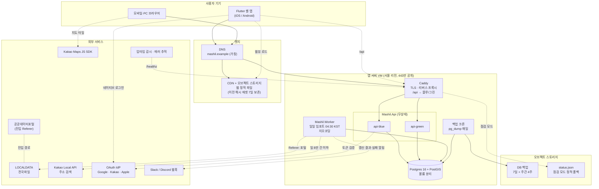
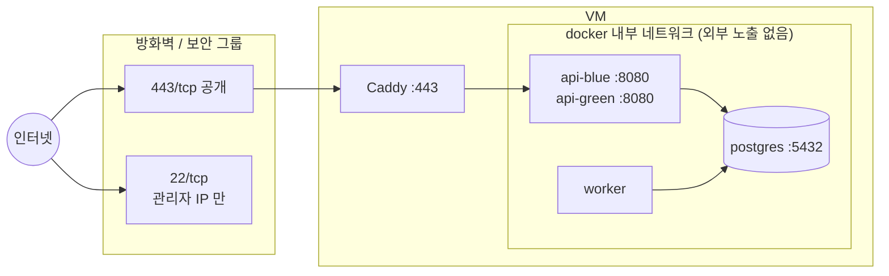
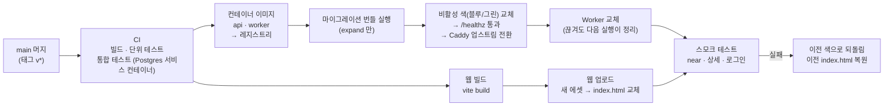

# 마실 배포 인프라 설계 (출시 대비)

| 항목 | 내용 |
|---|---|
| 작성일 | 2026-11-14 |
| 상태 | 설계 (운영 서버 없음). 호스팅 플랫폼은 미결 사항 Q11 |
| 관련 | [05-operations.md](05-operations.md) (무중단 배포, 점검 모드), 요구사항 OPS-01~06, NFR-13~16 |

## 1. 요약

| 항목 | 출시 단계 (권장) | 성장 단계 |
|---|---|---|
| 리전 | **국내 (서울)**. LOCALDATA·Kakao 접근성, 지연 시간 (NFR-16) | 동일 |
| 앱 서버 | VM 1대 + Docker Compose. API 컨테이너 2개(블루/그린) + Worker 1개 | 관리형 컨테이너 서비스 (리비전 단위 트래픽 전환) |
| 리버스 프록시 | Caddy (자동 TLS, 헬스체크 기반 업스트림 전환) | 관리형 로드밸런서 |
| DB | 같은 VM의 Postgres 16 + PostGIS 컨테이너, 데이터 볼륨 분리 | **관리형 PostgreSQL (PostGIS 지원 확인 필요)** |
| 웹 (React) | 오브젝트 스토리지 + CDN (정적 호스팅) | 동일 |
| 백업 | 매일 `pg_dump` → 오브젝트 스토리지 (7일 + 주간 4주 보관) | 관리형 DB 자동 백업 + PITR |
| 비용 감각 | 월 수만 원대 (VM 2vCPU/4GB급 + 스토리지·CDN 소량) | 월 십만 원대 이상. 플랫폼별 견적 필요 |

> 비용은 대략적인 감각이다. 실제 금액은 Q11에서 플랫폼을 정한 뒤 견적으로 확인한다.

**출시 단계를 VM 1대로 시작하는 이유:**
- 트래픽 규모가 작다. 근접 검색은 PostGIS 인덱스 쿼리 하나이고, 일일 갱신 부하도 거의 없다 (하루 수십 건 변경).
- 무중단 배포는 API 컨테이너 2개와 Caddy만으로 된다 (05-operations §3.4).
- 원본 데이터는 LOCALDATA에서 언제든 다시 받을 수 있다. DB를 잃어도 **사용자 데이터(계정·평점·댓글·관리자 수정)**만 백업에서 복구하면 된다.

## 2. 전체 구성도 (출시 단계)

## 3. 네트워크와 보안

| 항목 | 규칙 |
|---|---|
| 공개 포트 | 443만. 80은 Caddy가 443으로 리다이렉트 |
| DB | 외부 포트를 열지 않는다. 관리 작업은 SSH 터널로 |
| SSH | 키 인증만, 관리자 IP 허용 목록 |
| 시크릿 | 서버 환경 변수 파일(`/etc/mashil/*.env`, 권한 600) 또는 플랫폼 시크릿 저장소. 저장소에는 넣지 않는다 (기존 README 정책) |
| 필요한 시크릿 | `ConnectionStrings__Postgres`, `Jwt__SigningKey`(kid 롤오버), `Kakao__RestApiKey`, OAuth 클라이언트 시크릿·Apple 키(.p8), `Alerts__WebhookUrl` |
| Kakao 키 | JS 키는 웹 도메인을 Kakao 콘솔에 등록. REST 키는 서버에서만 사용 |
| CORS | 운영 웹 도메인만 허용 (지금은 `localhost:5173` 고정이므로 설정으로 분리 필요) |
| 위치 정보 | 접근 로그의 `lat`·`lng` 쿼리는 마스킹하거나 절삭 (NFR-06) |

## 4. 배포 파이프라인

| 단계 | 내용 | 비고 |
|---|---|---|
| CI | `dotnet test` (단위 + 통합). 통합 테스트는 PostGIS 서비스 컨테이너와 `MASHIL_TEST_DB`로 실행 | 지금 저장소 구조 그대로 가능 |
| 이미지 | `Dockerfile` 하나에 타깃 3개: `api`(aspnet:10.0, 366MB) / `worker`(runtime:10.0, 317MB) / `migrate`(EF 번들, runtime-deps) | **구현됨 (2026-11-14)**. 로컬에서 세 이미지 모두 빌드·기동 확인 |
| 마이그레이션 | `dotnet ef migrations bundle`로 만든 실행 파일을 배포 단계에서 1회 실행. 앱 시작 시 자동 실행하지 않는다 (OPS-03) | Worker는 미적용 마이그레이션이 있으면 시작하지 않음 (구현됨) |
| 블루/그린 | 비활성 색 컨테이너를 새 이미지로 올리고 `/healthz`가 통과하면 Caddy 업스트림을 전환. 이전 색은 30초 graceful shutdown 후 종료 | Caddy `reverse_proxy` + `health_uri` |
| Worker | 단일 인스턴스. 임포트 중에 교체되면 advisory lock과 Abandoned 정리로 다음 실행이 복구 (구현됨) | |
| 웹 | 해시 에셋을 먼저 올리고 `index.html`을 마지막에 교체. `index.html`은 `no-cache` | OPS-04 |

## 5. 데이터 보호와 복구

| 데이터 | 다시 만들 수 있나 | 보호 방법 |
|---|---|---|
| 공공데이터 원본·정규화 결과 (`raw_toilet_records`, `toilets` 기본 필드, `opening_schedules`) | **예** — LOCALDATA에서 다시 받아 임포트 (약 20초) | 백업에 포함하되 필수는 아님 |
| 지오코딩 결과 (`geocode_cache`, 지오코딩 오버라이드) | 예, 하지만 API 호출 약 5만 건(하루 한도 내) 필요 | 백업 필수 |
| 도보 도로망 (`walk_edges`, 약 371만 행) | **예** — OSM 추출본(약 280MB)을 받아 `tools/Mashil.OsmImport` 로 약 1분 30초 | 백업에서 빼도 된다 (용량이 커서 덤프에서 제외 검토) |
| **사용자 데이터** (계정, 평점, 댓글, 신고, 변경 요청) | **아니오** | 매일 백업, 복구 훈련 |
| **관리자 작업** (관리자 오버라이드, 매핑 사전, 이슈 처리 이력) | **아니오** | 매일 백업 |

- **RPO 24시간, RTO 2시간**을 출시 목표로 둔다 (사이드 프로젝트 규모 기준). 관리형 DB로 옮기면 PITR로 RPO를 분 단위로 줄인다.
- 백업 복구는 분기마다 한 번 별도 DB에 실제로 복원해서 확인한다.

## 6. 감시

| 대상 | 방법 | 알림 |
|---|---|---|
| API 생존 | 외부 업타임 감시가 `/healthz`를 1분마다 확인 | 연속 3회 실패 시 |
| 일일 갱신 | Worker의 `DailyImportJob` 결과 알림 (구현됨): 실패, 검증 거부, 대량 삭제 보류, 48시간 신선도 | 웹훅 |
| 지오코딩 | 일일 예산 소진, Kakao 429/401 시 다음 날까지 중단 (구현됨) | 로그 → 웹훅 연결은 TODO |
| 에러 | API·Worker 예외를 에러 추적 서비스로 | 신규 에러 |
| 디스크 | DB 볼륨 사용률 80% | 웹훅 |

## 7. 환경

| 환경 | 구성 | 용도 |
|---|---|---|
| 로컬 | docker-compose의 Postgres + `dotnet run` (지금) | 개발 |
| 스테이징 (권장) | 운영과 같은 VM 구성의 소형 인스턴스, 별도 DB | 스토어 심사용 빌드가 붙는 서버, 마이그레이션 리허설 |
| 운영 | §2 구성 | |

스토어 심사 기간에는 심사용 앱이 **스테이징 API**를 보게 해서, 운영 배포가 심사에 영향을 주지 않게 한다.

## 8. 출시 전 인프라 체크리스트

- [ ] Q11: 호스팅 플랫폼과 리전 결정 (국내 리전 필수)
- [ ] 도메인, DNS, TLS (Caddy 자동)
- [x] Dockerfile(api·worker·migrate)과 운영용 Compose·Caddyfile·배포 스크립트 — 백엔드 `Dockerfile`, `deploy/` (2026-11-14, 로컬 빌드·기동·문법 검증)
- [ ] CI 파이프라인 (테스트 → 이미지 → 마이그레이션 번들 → 블루/그린) — `deploy/deploy.sh` 를 CI 에서 호출하는 형태
- [x] CORS 를 설정으로 분리 (`Cors:Origins`)
- [ ] Kakao JS 키 도메인·OAuth 리디렉트 URI를 운영 도메인으로 등록
- [ ] **운영 서버에서 LOCALDATA 다운로드 시험** (`--fetch`, 로컬에서는 포털 Referer 로 성공)
- [ ] 백업 크론과 복구 리허설 (Compose `backup` 서비스를 호스트 cron 에서 실행)
- [ ] 업타임 감시와 웹훅 연결
- [x] `/healthz`(liveness)와 `/healthz/ready`(readiness, DB 확인) 분리
- [ ] 점검 모드 `status.json` 정적 폴백 경로
- [x] 위치 쿼리 로그 마스킹 (NFR-06) — Caddy 접근 로그에서 `lat`·`lng`·bbox 쿼리 제거
- [ ] 도보 도로망 적재: 운영 DB 에 마이그레이션(P8) 뒤 `dotnet run --project tools/Mashil.OsmImport -- --pbf <south-korea-latest.osm.pbf>` (같은 폴더에 `.md5`). 메모리 수 GB 를 쓰므로 운영 서버가 아니라 작업용 PC 나 CI 에서 돌려 DB 에 넣는다. 월 1회 정도 갱신. 경로 API 는 위치를 본문(POST)으로 받으므로 접근 로그 마스킹 대상이 아니다
