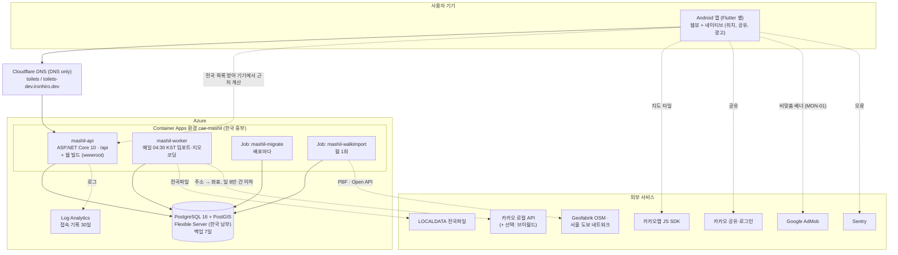
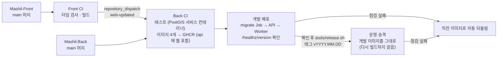

# 마실 배포 인프라

| 항목 | 내용 |
|---|---|
| 작성일 | 2026-11-14 (VM 구성 설계) · **2026-11-26 실제 운영 구성으로 다시 씀** |
| 상태 | 운영 중. Azure Container Apps (한국 중부) + PostgreSQL Flexible Server (한국 남부). 미결 Q11 은 이것으로 정해졌다 |
| 실행 절차 | 백엔드 저장소 `docs/AZURE.md` (리소스·설정·배포), `docs/RELEASE.md` (운영 승격), `docs/LAUNCH.md` (OAuth·Sentry·App Links 값 넣기). 이 문서는 구성과 이유만 적는다 |
| 관련 | [05-operations.md](05-operations.md) (무중단 배포, 점검 모드), 요구사항 OPS-01~06, NFR-13~16 |

> 처음 설계(VM 1대 + Docker Compose + Caddy 블루/그린, 오브젝트 스토리지 + CDN 의 웹)는 쓰지 않는다. 그 구성의 파일(백엔드 `deploy/`, `docs/OPERATIONS.md`)은 VM 으로 옮길 일이 생길 때를 위해 남아 있다.

## 1. 요약

| 항목 | 구성 |
|---|---|
| 리전 | 앱: **한국 중부**. DB: **한국 남부** (이 구독은 한국 중부 PostgreSQL 이 막혀 있음, `SkuNotAvailable`) |
| 웹 + API | Container App `mashil-api` 하나. 이미지에 웹(Mashil-Front main)의 빌드가 `wwwroot` 로 들어 있어 **한 도메인에서 웹과 `/api`** 를 낸다. 0.5 vCPU, 1GiB. 운영 최소 1 |
| Worker | `mashil-worker`. 매일 04:30 KST LOCALDATA 임포트, 카카오 로컬 API 지오코딩. 0.25 vCPU, 인그레스 없음 |
| 작업 (Job) | `mashil-migrate` (배포마다 CI 가 실행), `mashil-walkimport` (월 1회 도보 도로망 교체) |
| DB | PostgreSQL 16 Flexible Server, Burstable B1ms, 32GB, PostGIS. DB `mashil`(운영)·`mashil_dev`(개발) |
| 개발 서버 | 같은 Container Apps 환경의 `-dev` 앱들 (최소 0, 쓰지 않을 때 거의 비용 없음) |
| 이미지 | `ghcr.io/ironhiro/mashil-{api,worker,migrate,osmimport}` (공개 패키지) |
| 도메인 | `toilets.ironhiro.dev` (운영), `toilets-dev.ironhiro.dev` (개발). Cloudflare DNS only + Container Apps 관리형 인증서 |
| 비용 | 월 약 $30~40 (DB 약 $23 + Container Apps $5~15). 백엔드 `docs/AZURE.md` §비용 |

**VM 대신 Container Apps 를 쓴 이유:** 블루/그린 전환(리비전 단위 트래픽 전환), TLS, 재시작을 플랫폼이 맡아서 Caddy·cron·배포 스크립트를 직접 돌보지 않아도 된다. 웹을 API 이미지에 넣어 CDN 과 오브젝트 스토리지도 없앴다. 트래픽이 작아 최소 사양으로 충분하다.

## 2. 전체 구성도

- 사용자 위치는 서버로 가지 않는다. 앱이 전국 목록(약 5.2만 건, br 약 1.5MB)을 받아 근처 찾기·추천·검색을 기기에서 한다 (01 요구사항 첫 출시 범위, 처리방침).
- 마실은 앱 전용이다 (USR-04). 브라우저로 오면 설치 안내 화면이 나온다.

## 3. 네트워크와 보안

| 항목 | 규칙 |
|---|---|
| 공개 입구 | `mashil-api` 의 외부 인그레스(HTTPS)만. Worker·Job 은 인그레스 없음 |
| TLS | Container Apps 관리형 인증서. `.dev` 는 HSTS 사전 목록이라 HTTPS 만 열린다 |
| 보안 헤더 | VM 의 Caddy 대신 API 가 낸다 (HSTS, nosniff, X-Frame-Options, `Server` 숨김 — 백엔드 `Ops/WebHosting.cs`) |
| 실제 접속 IP | `ForwardedHeaders__TrustIngress=true`. X-Forwarded-For 의 마지막 값(인그레스가 붙인 값)만 믿는다 |
| DB | `--public-access 0.0.0.0` = Azure 안의 서비스만 허용. 관리 작업(도보망 임포트 등)은 그때만 관리자 PC IP 규칙(`admin-pc`)을 열고 끝나면 지운다 |
| 시크릿 | Container Apps 시크릿(`secretref:`). 공개 식별자(앱 ID, 클라이언트 ID)는 환경 변수. 저장소에는 넣지 않는다. 배포용 서비스 주체는 Back 저장소 시크릿 `AZURE_CREDENTIALS` (리소스 그룹 범위 contributor) |
| CORS | 웹과 API 가 같은 도메인이라 쓰지 않는다 (`Cors__Origins` 비움) |
| 위치 정보 | 접근 로그는 경로만 남기고 쿼리 문자열(`lat`·`lng`)은 남기지 않는다. 도보 경로 좌표는 POST 본문이라 로그에 없다 (NFR-06) |
| 카카오 REST 키 | Worker 만 쓴다. 콘솔에서 호출 허용 IP 를 걸면 Container Apps 나가는 IP 대역을 넣는다 (백엔드 `docs/AZURE.md`) |

## 4. 배포 파이프라인

| 단계 | 내용 |
|---|---|
| 계기 | Back main push 또는 `web-updated` → **개발**. `v2026.11.17` 형식 태그 push → **운영** (같은 날 두 번째부터 `.2`, `.3`) |
| 이미지 | `Dockerfile` 타깃 `api`·`worker`·`migrate`·`osmimport`. 태그 = 커밋 sha (+ 운영 승격 때 버전 태그) |
| 마이그레이션 | 배포마다 `migrate` Job 을 먼저 실행. 앱 시작 때 자동 실행하지 않는다. expand/contract 규칙(OPS-03): 새 스키마가 직전 API 와도 동작해야 한다 |
| 무중단 | 새 리비전이 준비되면 트래픽 전환 (Container Apps). 점검(`/healthz/version` 으로 새 리비전·커밋 확인)이 실패하면 직전 이미지로 되돌림 (`deploy/azure/ci-deploy.sh`) |
| 운영 승격 | `tools/release.sh` 는 개발 서버가 실제로 돌리는 커밋이 main 과 같을 때만 태그를 만든다. 릴리스 작업은 태그 커밋과 개발 서버 커밋이 다르면 멈춘다 → **개발에서 확인한 이미지만 운영에 간다** |
| 승인 | GitHub 환경 `production` 에 승인자를 걸 수 있다 (지금은 없음 = 태그 push 가 곧 배포) |
| 앱 | 서버와 따로 나간다. App CI 는 analyze·test 만. Play 에 올릴 AAB 는 업로드 키(`android/key.properties`)가 있는 컴퓨터에서 `env/prod.json` 으로 빌드 |

## 5. 데이터 보호와 복구

| 데이터 | 다시 만들 수 있나 | 보호 방법 |
|---|---|---|
| 공공데이터 원본·정규화 결과 (`raw_toilet_records`, `toilets` 기본 필드, `opening_schedules`) | **예** — LOCALDATA 에서 다시 받아 임포트 | DB 백업에 포함 |
| 지오코딩 결과 (`geocode_cache`, 지오코딩 오버라이드) | 예, 하지만 API 호출 약 5만 건(초당 약 2.5건, 6시간쯤) 필요 | DB 백업. 개발 DB 에는 운영 캐시를 복사해 호출을 아낀다 |
| 도보 도로망 (`walk_edges`, 약 371만 행) | **예** — `walkimport` Job 이 월 1회 다시 만든다 | 교체 전 건수 검사(지금의 80% 이상일 때만 교체) |
| **사용자 데이터** (계정, 평점, 댓글, 신고, 변경 요청) | **아니오** | DB 백업 |
| **관리자 작업** (관리자 오버라이드, 매핑 사전, 이슈 처리 이력) | **아니오** | DB 백업 |

- 백업: Flexible Server 자동 백업, **보관 7일**, 지역 중복 백업 꺼짐, 고가용성(HA) 꺼짐 (2026-11-26 확인). 그 안의 시점으로 복원(PITR)할 수 있다. VM 설계의 `pg_dump` 크론과 주간 4주 보관은 없다.
- 목표: RPO 24시간 이하(PITR 로 실제로는 분 단위), RTO 2시간.
- 복원 리허설: 별도 서버로 시점 복원해 확인한다 (분기 1회). **아직 기록 없음 — 확인 필요**.

## 6. 감시

2026-11-26 에 `az` 로 확인했다. **Azure 쪽 경고는 하나도 없다**: 메트릭 경고 규칙, 로그 경고 규칙, 작업 그룹(알림 받는 곳), Application Insights·가용성 테스트 모두 0개.

| 대상 | 방법 | 상태 (2026-11-26) |
|---|---|---|
| 배포 | 배포마다 `/healthz/version` 으로 리비전·커밋 확인, 실패하면 자동 되돌림 | 동작함 |
| 접속 기록·로그 | Log Analytics 작업 영역, **보관 30일** (처리방침의 "접속 기록 30일"과 같아야 한다) | 동작함 |
| 웹 오류 | Sentry. 같은 웹 빌드가 개발 → 운영으로 승격되므로 environment 는 접속 호스트로 정한다 (Mashil-Front `src/lib/sentryEnv.ts`, DSN 은 빌드 변수 `VITE_SENTRY_DSN`) | 웹 쪽 구현됨 |
| 서버 오류 | API·Worker 의 `Sentry__Dsn` | **꺼짐** — 두 앱 모두 `Sentry__Environment` 만 있고 DSN 이 없다 |
| API 생존 | 외부 업타임 감시가 `/healthz/ready` 를 1분마다 (DB 까지 확인), 3회 연속 실패 시 알림 | **없음** — Azure 가용성 테스트 없음. 외부 서비스(UptimeRobot 등) 가입 여부는 본인 확인 |
| 일일 갱신 | Worker 가 실패·검증 거부·대량 삭제 보류·48시간 신선도를 `Alerts__WebhookUrl` 로 | **켬 (2026-11-26)** — 운영 Worker 만, Discord 웹후크 (시크릿 `alert-webhook`). 개발 Worker 에는 넣지 않는다 |
| 지오코딩 | 일일 예산(`Geocode:DailyBudget` 80,000 — 운영·개발이 카카오 무료 한도를 나눠 씀) 소진, 429/401 이면 다음 날까지 쉼 | 동작함 (로그만) |
| DB 용량 | 32GB 중 **약 21% 사용** (2026-11-26). 도보망 교체 때 잠깐 약 1GB 더 | **자동 증가 켬 (2026-11-26)** — 꽉 차도 읽기 전용이 되지 않고 늘어난다 (줄일 수는 없음). 80% 경고는 아직 없음 |

## 7. 환경

| 환경 | 주소 | 구성 | 용도 |
|---|---|---|---|
| 로컬 (Windows PC) | 에뮬레이터 `http://10.0.2.2:5173` | docker-compose PostGIS + `dotnet run` + Vite | 개발 |
| 로컬 (Mac) | 시뮬레이터 `http://localhost:5173` | 같은 구성. .NET 10 은 `brew install dotnet@10`, Docker 는 Desktop 컨텍스트 (앱 README "iOS 시뮬레이터") | 개발 |
| 개발 (스테이징) | **`https://toilets-dev.ironhiro.dev`** | `mashil-*-dev` + DB `mashil_dev` | main 이 바로 올라가는 곳. 운영 승격 전 확인, 마이그레이션 리허설 |
| 운영 | **`https://toilets.ironhiro.dev`** | `mashil-*` + DB `mashil` | 날짜 태그로만 바뀐다 |

웹과 API 는 한 도메인에서 (`/api` 는 API, 나머지는 웹). 웹이 `/api` 를 상대 경로로 불러 CORS 가 필요 없고, 공유 링크도 페이지 주소를 그대로 쓴다.

| 어디 | 무엇 |
|---|---|
| Cloudflare DNS (`ironhiro.dev`) | `toilets`, `toilets-dev` CNAME·TXT (백엔드 `deploy/azure/domains.sh` 가 출력). **DNS only** — 프록시를 켜면 실제 접속 IP 처리를 다시 봐야 한다 |
| Kakao Developers → JavaScript SDK 도메인 | `https://toilets.ironhiro.dev`, `https://toilets-dev.ironhiro.dev` (지도 SDK·카카오톡 공유) |
| Kakao Developers → 제품 링크 관리 → 웹 도메인 | 같은 두 주소 (카카오톡 공유 카드 링크) |
| 앱 빌드 | `app/env/prod.json`, `app/env/staging.json` (커밋하지 않음): `WEB_BASE_URL`·`API_BASE_URL` 을 각 주소로. 광고는 `ADS_ENABLED` 등 (MON-01). `flutter build appbundle --release --dart-define-from-file=env/prod.json` |
| GitHub (Mashil-Back) | 시크릿 `AZURE_CREDENTIALS`, 변수 `AZURE_DEPLOY=true`·`AZURE_RESOURCE_GROUP`·`VITE_KAKAO_MAP_KEY`·`VITE_SENTRY_DSN` |

스토어 심사 기간에는 심사용 앱이 **개발 서버**를 보게 해서, 운영 배포가 심사에 영향을 주지 않게 할 수 있다 (`env/staging.json` 빌드).

## 8. 점검 모드 (OPS-05)

| 경우 | 방법 |
|---|---|
| 읽기 전용·전체 점검 (API 는 살아 있음) | 관리자 화면에서 `PUT /api/admin/app-status` (ADM-06). 웹은 자기 점검 화면, 앱은 웹을 못 불러올 때 네이티브 점검 화면 |
| 관리자 로그인이 안 될 때 | `mashil-api` 환경 변수 `App__Status__Maintenance=true` (또는 `ReadOnly`) 로 새 리비전 |
| API 자체를 내려야 할 때 | VM 설계의 `status.json` 정적 폴백(Caddy)은 **없다**. 앱은 웹을 못 불러오면 일반 오류 화면을 보인다. 필요해지면 정적 폴백을 둘 곳(예: 별도 정적 호스팅)을 정한다 |

## 9. 남은 일

- [x] 호스팅 플랫폼·리전 결정 (Q11 → Azure Container Apps, 한국 중부·남부)
- [x] 도메인·TLS (`toilets`, `toilets-dev`, 관리형 인증서)
- [x] CI 파이프라인 (테스트 → 이미지 → migrate Job → 리비전 전환 → 점검·자동 되돌림), 날짜 태그로 운영 승격
- [x] `/healthz`, `/healthz/ready`, `/healthz/version`
- [x] 위치 쿼리 로그 마스킹 (API 요청 로그)
- [x] 도보 도로망 월 1회 갱신 Job
- [ ] 업타임 감시 등록 (외부 서비스 또는 Application Insights 가용성 테스트) + 알림 받을 곳 (Azure 작업 그룹 또는 메일·웹훅) — 2026-11-26 기준 없음
- [x] 운영 Worker `Alerts__WebhookUrl` — Discord 웹후크 (2026-11-26)
- [ ] 서버 `Sentry__Dsn` (API·Worker, 시크릿으로) — 없음
- [x] DB 저장소 자동 증가 (2026-11-26)
- [ ] DB 저장소 사용률 80% 경고 + 알림 받을 곳 (작업 그룹)
- [ ] 시점 복원(PITR) 리허설 1회와 기록
- [ ] API 가 내려간 동안의 점검 안내 (정적 폴백) 필요 여부 결정
- [ ] 백엔드 `docs/OPERATIONS.md` 첫머리에 "VM 구성용, 운영은 AZURE.md" 표시 (지금은 "아직 운영 서버는 없다"로 되어 있음)
